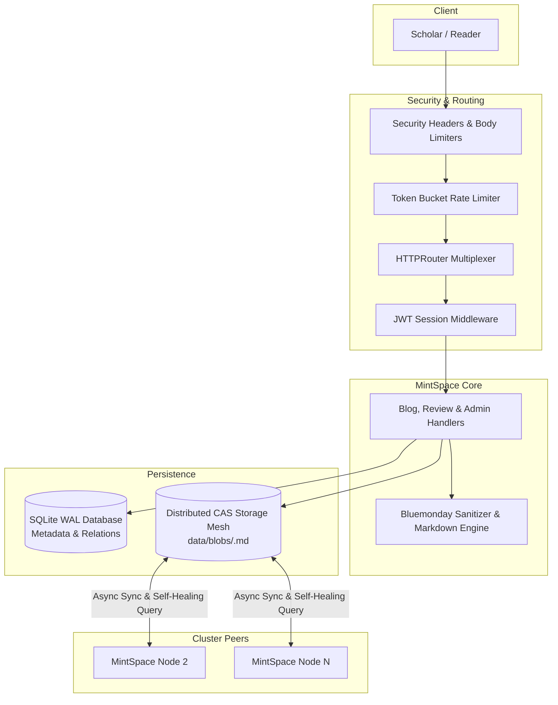

<div align="center">

# MINTSPACE

### Open Research Publishing Engine & Cryptographic Content-Addressable Storage

[](https://github.com/Supriyo-455/mintspace/actions/workflows/ci.yml)
[](https://go.dev/)
[](#content-addressable-storage-cas)
[](LICENSE)

*A distraction-free, research-grade publishing platform pairing calm academic typography with tamper-evident, decentralized Content-Addressable Storage (CAS).*

---

</div>

## Overview

Modern publishing platforms are saturated with noise, aggressive colors, and fragile relational database dependencies. **MintSpace** is built from first principles for authors, researchers, and systems engineers who value **content clarity**, **cryptographic provenance**, and **zero-indirection performance**.

Instead of storing articles as mutable database records, MintSpace treats every manuscript as a **first-class cryptographic artifact**:
* Relational metadata (authors, visibility, access control, threaded commentary) is maintained in high-concurrency pure-Go SQLite.
* Manuscript payloads are stored in an immutable **Content-Addressable Storage (CAS)** mesh, indexed strictly by their **SHA-256 hash** (`data/blobs/<sha256>.md`).
* When deployed across a cluster, nodes synchronize through a **self-healing distributed mesh**, cryptographically verifying every byte before serving.

---

## Key Features

### 1. Research Paper Reading Experience
* **Calm Academic Typography**: Tuned for long-form screen reading using **Constantia** (serif body prose) and **Consolas** (code listings).
* **LaTeX Mathematical Formalism**: Inline formulas ($\int_a^b f(x)dx$) and display equations ($\mathcal{P} = \langle \mathcal{A}, \mathcal{T}, \mathcal{H} \rangle$) rendered natively via **KaTeX**.
* **Interactive Scientific Diagrams**: Built-in support for **Mermaid.js** flowcharts and architecture diagrams with an interactive **Full-Screen Lightbox** (zoom from 20% to 500%, mouse drag pan, reset, and keyboard shortcuts).
* **Syntax-Highlighted Code Blocks**: Academic code listings with language identification badges and one-click clipboard copying.
* **One-Click BibTeX Citation**: Auto-generates standardized BibTeX citations with embedded SHA-256 hashes for cryptographic reference.
* **Publication-Grade Vector PDF Export**: Dedicated one-click "Download PDF" feature generating crisp, multi-page vector PDFs with full document fidelity—including native vector Mermaid flowcharts, KaTeX formulas, wrapped code listings, running archival headers, and cryptographic colophon footers.

### 2. Cryptographic Content-Addressable Storage (CAS)
* **Tamper-Evident Publishing**: If a single character is modified, its content hash changes immediately, alerting readers to content alteration.
* **Automatic Deduplication**: Identical manuscripts resolve to the exact same content-addressed file, saving disk space and bandwidth.
* **Inspectable Raw Blobs**: Raw Markdown payloads can be inspected directly via `/blob/<hash>`.

### 3. Multi-Machine Distributed Storage Mesh
* **Self-Healing Peer Resolution**: If a node lacks a requested manuscript locally, it queries cluster peers (`PEER_NODES`), cryptographically verifies that $\text{SHA-256}(\text{received}) == \text{requested\_hash}$, persists it locally, and serves it.
* **Asynchronous Peer Replication**: Publishing on one node broadcasts a background replication signal (`POST /api/v1/sync/blob`) to cluster peers.
* **In-Memory Hot Read Cache**: Frequently accessed manuscripts are served directly from RAM without touching disk.

### 4. Threaded Peer Commentary
* **Hierarchical Review Trees**: Nested discussion threads allowing scholars to critique manuscripts and reply inline to specific reviews.
* **Endorsement Mechanics**: Cryptographic likes on both manuscripts and individual review notes.
* **Retraction & Deletion**: Authors and administrators can delete review notes with automatic cascade cleanup of nested replies.

### 5. Access Control & Editorial Console
* **Public vs. Restricted Papers**: Authors can mark manuscripts as private or public with strict authorization boundaries.
* **Editorial Board Console (`/admin`)**: Administrative dashboard for auditing platform statistics, retracting papers, and managing editor roles.

### 6. Security Hardening & Concurrency
* **Path Traversal Protection**: Strict 64-character hexadecimal SHA-256 validation prevents path traversal (`../../`).
* **IP Token-Bucket Rate Limiter**: Built-in rate limiting protects authentication (`/login`, `/signup`) and publishing endpoints against brute force and DoS.
* **Security Headers**: Standard `X-Frame-Options: DENY`, `X-Content-Type-Options: nosniff`, and `Referrer-Policy`.
* **Zero-CGO SQLite WAL**: Embedded pure-Go SQLite with Write-Ahead Logging handles concurrent reading without locking writers.

---

## Architecture



---

## Quickstart

### Prerequisites
* Go 1.23 or newer (**No CGO or GCC required**).

### 1. Run Locally
```bash
# Clone the repository
git clone https://github.com/Supriyo-455/mintspace.git
cd mintspace

# Download dependencies
go mod download

# Run the server
go run .
```

Open `http://127.0.0.1:3000` in your browser.

### Default Administrator
* **Email**: `admin@mintspace.io`
* **Password**: `admin123`

---

## Automated Test Suite

MintSpace includes a test suite covering database operations, CAS integrity, rate limiting, and distributed mesh replication:

```bash
# Run all tests
go test -v ./...

# Run tests with race detection
go test -race -v ./...
```

### Verified Test Cases:
| Test Case | Description |
| :--- | :--- |
| `TestCommentDeletion` | Verifies comment retraction, author permissions, and recursive cascade deletion. |
| `TestArchiveAndPaperView` | Tests paper index archive rendering and manuscript view pages. |
| `TestWriteBlogAndCASVerification` | Verifies Markdown upload, SHA-256 calculation, and CAS storage creation. |
| `TestLikesAndComments` | Validates endorsement counters and threaded reply trees. |
| `TestPrivateBlogRestrictions` | Tests authorization boundaries protecting private manuscripts. |
| `TestAdminConsole` | Validates role-based access control and editorial moderation tools. |
| `TestHealthzEndpoint` | Tests `/healthz` cluster status metrics for load balancers. |
| `TestSecurityHeaders` | Verifies `X-Frame-Options`, `nosniff`, and referrer policies. |
| `TestPathTraversalProtection` | Validates strict rejection of malformed or traversal hashes (`../../`). |
| `TestRateLimiter` | Tests token bucket burst capacity and throttling under burst traffic. |
| `TestDistributedCASMeshSync` | Verifies cross-node peer resolution, hash verification, and self-healing local storage. |

---

## Docker & Multi-Node Cluster

Launch a 2-node self-healing cluster behind a Caddy reverse proxy with automatic SSL:

```bash
docker compose up -d
```

* **Caddy Load Balancer**: `http://localhost` (or configured HTTPS domain).
* **Node 1 Health Check**: `http://localhost:3000/healthz`.

---

## Deep Documentation

* [System Architecture & Data Flow](docs/ARCHITECTURE.md)
* [Distributed CAS Storage Protocol & Mesh](docs/DISTRIBUTED_STORAGE.md)
* [Security Hardening & Scaling Architecture](docs/SECURITY_AND_SCALING.md)
* [Build, Test & Deployment Guide](docs/BUILD_AND_TEST.md)
* [Concepts, Philosophy & Roadmap](docs/CONCEPTS_AND_ROADMAP.md)

---

## License

MintSpace is open source software licensed under the [MIT License](LICENSE).
