# Building Handmade Hero: A Professional Low-Level Game Engine Guide from First Principles

## Table of Contents
- [Introduction: The Handmade Philosophy & Systems Architecture](#introduction-the-handmade-philosophy--systems-architecture)
- [Module 1: The Build Environment & Tooling](#module-1-the-build-environment--tooling)
- [Module 2: The Hourglass Architecture — Decoupling Platform from Engine Logic](#module-2-the-hourglass-architecture--decoupling-platform-from-engine-logic)
- [Module 3: Memory & Core Data Structures](#module-3-memory--core-data-structures)
- [Module 4: High-Performance Multi-Threading from First Principles](#module-4-high-performance-multi-threading-from-first-principles)
- [Module 5: Subsystem Implementation (Step-by-Step)](#module-5-subsystem-implementation-step-by-step)
  - [Subsystem 5.1: Math, SIMD Intrinsics & Coordinate Systems](#subsystem-51-math-simd-intrinsics--coordinate-systems)
  - [Subsystem 5.2: Platform Abstraction & Hot Code Reloading](#subsystem-52-platform-abstraction--hot-code-reloading)
  - [Subsystem 5.3: High-Performance Multi-Threaded Work Queue](#subsystem-53-high-performance-multi-threaded-work-queue)
  - [Subsystem 5.4: Rendering Pipeline - Software Rasterizer & Hardware OpenGL](#subsystem-54-rendering-pipeline---software-rasterizer--hardware-opengl)
  - [Subsystem 5.5: Entity System, Simulation Regions & Spatial Chunking](#subsystem-55-entity-system-simulation-regions--spatial-chunking)
  - [Subsystem 5.6: Audio Mixing Engine](#subsystem-56-audio-mixing-engine)
  - [Subsystem 5.7: Asset Streaming & File Formats](#subsystem-57-asset-streaming--file-formats)
- [Module 6: The Execution Pipeline](#module-6-the-execution-pipeline)
- [Module 7: Profiler Micro-Architecture, Instrumentation & Collation Engine](#module-7-profiler-micro-architecture-instrumentation--collation-engine)
- [Module 8: The Immediate-Mode Developer UI (IMGUI) Subsystem](#module-8-the-immediate-mode-developer-ui-imgui-subsystem)
- [Module 9: Deep-Dive Memory Tracking, Auditing & Hardware Verification](#module-9-deep-dive-memory-tracking-auditing--hardware-verification)
- [Conclusion & Master Architectural Summary](#conclusion--master-architectural-summary)

---

# Introduction: The Handmade Philosophy & Systems Architecture

Welcome to the deep end of the pool. If you have spent your career living in the comfortable, padded world of modern software engineering—surrounded by gigabytes of C++ standard template libraries, managed garbage collectors, multi-layered object-oriented hierarchies, and opaque third-party game engines—it is time to set all of that aside.

We are going to build a complete, professional-grade 2D/3D game engine and game from first principles in C/C++. No external engines. No third-party frameworks. Not even the standard C Runtime Library (CRT). 

### The Core Engineering Philosophy

When you look at modern software development, there is an unspoken assumption that computers are slow and software must be complex. But if you look at the raw hardware beneath your operating system, the reality is staggering: a modern CPU executes billions of clock cycles per second across multiple SIMD-capable cores, processes memory at tens of gigabytes per second, and communicates with GPUs capable of tens of teraflops of compute.

Why, then, does modern software crawl? It crawls because developers have abandoned the machine. Layers upon layers of indirection, pointer chasing, dynamic heap allocations (`malloc`, `new`), cache-unfriendly abstractions, virtual method tables, and uncontrolled framework bloat isolate the programmer from what the transistor is actually doing.

```mermaid
flowchart TD
    subgraph Modern Bloatware Paradigm
        A1[Game Logic] --> A2[Engine Abstraction Layer]
        A2 --> A3[Virtual Object Model / STL]
        A3 --> A4[C Runtime / Heap Allocator]
        A4 --> A5[OS Kernel / Drivers]
        A5 --> A6[Physical Hardware]
    end

    subgraph The Handmade First-Principles Paradigm
        B1[Game Logic & Simulation] --> B2[Unified Platform API & Memory Arenas]
        B2 --> B3[SIMD / Cache-Aligned Memory Blocks]
        B3 --> B4[Direct Hardware / Register Execution]
    end
```

Our philosophy is built on five non-negotiable architectural pillars:

#### 1. Zero Is Initialization (ZII) Over RAII
In standard object-oriented C++, Resource Acquisition Is Initialization (RAII) encourages complex constructors, destructor chains, copy constructors, and exception-handling landing pads. In Handmade architecture, we adhere to **ZII**: every data structure is designed such that all zeros (`0`) represents a valid, pristine, default-initialized state. Zeroing a block of memory with a single SIMD vector wipe initializes hundreds of structs instantaneously without a single constructor call.

#### 2. Explicit Memory Ownership via Memory Arenas
The standard dynamic heap (`malloc`/`free`, `new`/`delete`) is a performance killer and the number-one source of software bugs: fragmentation, memory leaks, use-after-free, double-free, and cache misses. We ban mid-frame allocations entirely. Instead, the platform layer reserves large, contiguous blocks of virtual address space on startup. Memory is carved out linearly using **Memory Arenas** (`memory_arena`). Allocations are simple pointer bumps. Lifetime management is instantaneous and deterministic: rolling back a pointer frees an entire hierarchy of scratch allocations in zero clock cycles.

#### 3. Compression-Oriented & Data-Oriented Programming
We do not design class hierarchies or abstract "entity models" before writing a line of code. We write the simplest possible procedural code to solve the immediate problem, observe the actual shapes of the data, and compress repeated operations into clean, cache-friendly data transformations. We organize data in **Structures of Arrays (SoA)** or stream-packed layouts to maximize CPU L1/L2/L3 cache line utilization and enable automatic or explicit SIMD vectorization.

#### 4. Absolute Separation of Platform and Game Logic
The game engine does not know it is running on Windows, Linux, macOS, or a custom console. The platform layer (`win32_handmade.cpp`) owns the window, raw input devices, audio device buffers, and initial memory reservations. It exposes a lean, functional C contract (`game_memory`, `game_input`, `game_render_commands`) to the platform-independent game layer (`handmade.cpp`). The game engine is compiled as an isolated dynamic library (`handmade.dll`), enabling instantaneous **Live Hot Code Reloading** while the game is running without dropping a single frame or resetting game state.

#### 5. Explicit Pointer Passing & Zero Global State
Global state causes hidden dependencies and destroys multithreading scalability. In our engine, state is explicit. Every subsystem receives its state through explicit typed pointers passed down the stack. If a function needs to draw, it receives `game_render_commands*`. If it needs memory, it receives `memory_arena*`. The execution graph is 100% transparent and inspectable in the debugger at all times.


---


# Module 1: The Build Environment & Tooling

To master the machine, you must master the translator that turns your human-readable source code into machine opcodes: the compiler. Most modern developers hide behind IDE project files (`.vcxproj`, CMake, Xcode), completely unaware of the compiler and linker flags governing their binary output. 

In this module, we construct an industrial-grade, lightning-fast compilation pipeline from scratch using Microsoft Visual C++ (`cl.exe`) and Windows batch scripts, stripping away all standard library bloat and enforcing strict code correctness.

### Architecture: The Single Translation Unit & Hot Reload Architecture

Rather than compiling dozens of `.cpp` files into intermediate `.obj` files and linking them together—which wastes massive amounts of time reading headers repeatedly and prevents whole-program optimization—we employ a **Unified / Unity Build Architecture**. 

The entire game subsystem is included into a single translation unit (`handmade.cpp`), and the platform layer is compiled as another single translation unit (`win32_handmade.cpp`). This compiles in less than one second, provides the compiler with full visibility across all functions for automatic inlining, and outputs two distinct binaries:
1. `win32_handmade.exe`: The permanent host process that owns OS resources, audio buffers, and window handles.
2. `handmade.dll`: The transient game logic containing the simulation, renderer dispatch, and entity processing.

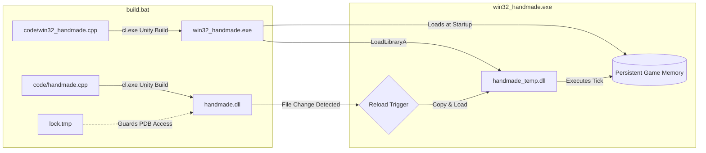

### Build Script Analysis: `build.bat`

Let us inspect the master compilation script located at `code/build.bat`. Every flag in this script is deliberate. We will analyze the compiler switches, the warning suppression strategy, the linker directives, and the synchronization lock file mechanism.

```bat
@echo off

REM --------------------------------------------------------------------
REM Performance Timer: Track build time across compilation runs
REM --------------------------------------------------------------------
ctime -begin handmade_hero.ctm

REM --------------------------------------------------------------------
REM Compiler Flags (cl.exe):
REM -diagnostics:column : Emit precise column numbers for errors/warnings
REM -WL                 : Output single-line diagnostics for cleaner terminal parsing
REM -O2                 : Maximize speed optimization (vectorization, register allocation)
REM -nologo             : Suppress the verbose Microsoft startup banner
REM -fp:fast            : Aggressive floating-point optimizations (disables strict IEEE compliance)
REM -fp:except-         : Disable floating-point exception handling (removes hardware traps)
REM -Gm-                : Disable minimal rebuilds (ensures clean, deterministic compilation)
REM -GR-                : Disable Run-Time Type Information (eliminates RTTI tables and vtable overhead)
REM -EHa-               : Disable C++ exception handling (no stack unwinding tables or landing pads)
REM -Zo                 : Generate rich debugging information even under -O2 optimization
REM -Oi                 : Enable compiler intrinsics (replaces calls to memset, memcpy with CPU opcodes)
REM -WX                 : Treat all compiler warnings as fatal errors
REM -W4                 : Enable Level 4 warnings (highest practical semantic analysis)
REM -FC                 : Emit full file paths in diagnostics for instant editor navigation
REM -Z7                 : Emit CodeView debugging symbols directly inside the object/PDB files
REM -GS-                : Strip buffer security checks (removes canary cookies on stack frames)
REM -Gs9999999          : Set stack probe threshold to 9.9MB, eliminating calls to __chkstk()
REM --------------------------------------------------------------------
set CommonCompilerFlags=-diagnostics:column -WL -O2 -nologo -fp:fast -fp:except- -Gm- -GR- -EHa- -Zo -Oi -WX -W4 -wd4201 -wd4100 -wd4189 -wd4505 -wd4127 -FC -Z7 -GS- -Gs9999999

REM --------------------------------------------------------------------
REM Warning Suppressions:
REM -wd4201 : Nameless struct/union (critical for vector math structs: v2, v3, v4)
REM -wd4100 : Unreferenced formal parameter (expected in callback stubs and platform interfaces)
REM -wd4189 : Local variable initialized but not referenced (useful during rapid prototyping)
REM -wd4505 : Unreferenced local function removed (routine in unity builds with static helpers)
REM -wd4127 : Conditional expression is constant (e.g., do {} while(0) and macro expansions)
REM --------------------------------------------------------------------

REM --------------------------------------------------------------------
REM Preprocessor Defines:
REM HANDMADE_INTERNAL=1 : Enables developer-only code, asserts, and internal diagnostics
REM HANDMADE_SLOW=1     : Enables expensive runtime checks and assertions
REM HANDMADE_WIN32=1    : Configures the target platform to Windows
REM --------------------------------------------------------------------
set CommonCompilerFlags=-DHANDMADE_INTERNAL=1 -DHANDMADE_SLOW=1 -DHANDMADE_WIN32=1 %CommonCompilerFlags%

REM --------------------------------------------------------------------
REM Linker Flags (link.exe):
REM -STACK:0x100000,0x100000 : Commit 1MB stack size
REM -incremental:no          : Disable incremental linking to prevent trampoline thunks
REM -opt:ref                 : Strip unreferenced functions and data from final binary
REM user32.lib gdi32.lib winmm.lib kernel32.lib : Core Windows kernel and user subsystems
REM --------------------------------------------------------------------
set CommonLinkerFlags=-STACK:0x100000,0x100000 -incremental:no -opt:ref user32.lib gdi32.lib winmm.lib kernel32.lib

IF NOT EXIST ..\data mkdir ..\data
IF NOT EXIST ..\..\build mkdir ..\..\build
pushd ..\..\build

del *.pdb > NUL 2> NUL

REM --------------------------------------------------------------------
REM Synchronization Lock: Signal to the running game that compilation is active
REM --------------------------------------------------------------------
echo WAITING FOR PDB > lock.tmp

REM --------------------------------------------------------------------
REM 1. Compile the OpenGL Renderer Dynamic Subsystem
REM --------------------------------------------------------------------
cl %CommonCompilerFlags% -MTd ..\handmade\code\win32_handmade_opengl.cpp -LD /link -incremental:no -opt:ref -PDB:win32_handmade_opengl_%random%.pdb -EXPORT:Win32LoadRenderer -EXPORT:Win32BeginFrame -EXPORT:Win32EndFrame gdi32.lib opengl32.lib user32.lib

REM --------------------------------------------------------------------
REM 2. Compile the Game Engine DLL
REM -Fm : Emit map file showing exact symbol layout in memory
REM -LD : Compile as a dynamic link library (DLL)
REM -PDB: Unique random PDB name prevents file-lock collisions with the debugger
REM -EXPORT: Explicitly export game update, render, and audio entry points
REM --------------------------------------------------------------------
cl %CommonCompilerFlags% -MTd -I..\iaca-win64\ ..\handmade\code\handmade.cpp ..\handmade\code\handmade_msvc.c -Fmhandmade.map -LD /link -incremental:no -opt:ref -PDB:handmade_%random%.pdb -EXPORT:GameGetSoundSamples -EXPORT:GameUpdateAndRender -EXPORT:DEBUGGameFrameEnd
set LastError=%ERRORLEVEL%

REM Delete lock file to signal win32_handmade.exe that DLL is ready to reload
del lock.tmp

REM --------------------------------------------------------------------
REM 3. Compile the Win32 Platform Host Executable
REM /NODEFAULTLIB : Reject the C standard runtime library completely
REM /SUBSYSTEM:windows : Target standard Win32 GUI without spawning a console
REM --------------------------------------------------------------------
cl %CommonCompilerFlags% ..\handmade\code\win32_handmade.cpp ..\handmade\code\handmade_msvc.c -Fmwin32_handmade.map /link /NODEFAULTLIB /SUBSYSTEM:windows %CommonLinkerFlags%

popd
ctime -end handmade_hero.ctm %LastError%
```

### Deep Dive: Bypassing the C Runtime Library (`/NODEFAULTLIB`)

Notice the `/NODEFAULTLIB` switch when compiling `win32_handmade.cpp`. In traditional C/C++, when you compile a program, the compiler invisibly links `msvcrt.lib` or `libcmtd.lib`. The CRT adds hidden startup overhead: static constructor iterators, locale tables, floating-point initialization, and memory allocator hooks.

By dropping the CRT, we gain 100% control over execution. The true entry point called by the operating system kernel is `WinMainCRTStartup()`, which simply unpacks the command-line arguments and calls our `WinMain()`.

Furthermore, consider the flags `-GS-` and `-Gs9999999`:
* `-GS-` turns off the compiler's buffer overrun security check. With `-GS`, the compiler inserts code at the beginning and end of every function to write and verify a canary value on the stack. If violated, it calls `__report_rangecheckfailure`—which resides in the CRT! Without `-GS-`, building with `/NODEFAULTLIB` would cause linker errors.
* `-Gs9999999` raises the stack probe threshold. Normally, when a function allocates more than one page (4096 bytes) on the stack, the compiler inserts a call to `__chkstk()` to touch pages sequentially so the OS can expand the stack guard page. Raising this threshold guarantees the compiler never generates an external call to `__chkstk`.

### The Random PDB Trick & `lock.tmp`

In Windows, when an application loads a `.dll` via `LoadLibraryA()`, the operating system locks the executable file on disk. Even worse, if a debugger (such as Visual Studio or RemedyBG) is attached to the process, it locks the `.pdb` (Program Database) containing debug symbols.

If you attempt to recompile `handmade.dll` while the game is running, the compiler will fail with:
`fatal error LNK1104: cannot open file 'handmade.pdb'`

Handmade Hero solves this with an ingenious, zero-latency mechanism:
1. `build.bat` writes `echo WAITING FOR PDB > lock.tmp`.
2. When calling the linker, we pass `-PDB:handmade_%random%.pdb`. The `%random%` environment variable generates a unique PDB name on every compile (e.g., `handmade_18429.pdb`). The debugger attaches to the newly generated PDB without conflicting with the locked old PDB.
3. Once linking succeeds, `del lock.tmp` deletes the lock file.
4. The platform host checks for the presence of `lock.tmp` using `GetFileAttributesExA()`. If the lock exists, it knows the compiler is halfway through linking and waits before reading the DLL, eliminating race conditions and binary corruption.

---

### Debugging, Diagnostics & Profiling

Understanding how to inspect and diagnose your build output is just as important as writing the code itself.

#### Compiler Diagnostics & Map File Inspection
When `-Fmhandmade.map` is passed to the linker, MSVC emits an ASCII text file containing every symbol, its segment offset, and its memory layout:

```text
handmade.map:
 Address         Publics by Value              Rva+Offset      Lib:Object
 0001:00001040   GameUpdateAndRender           0000000180002040 f handmade.obj
 0001:00004520   OutputPlayingSounds           0000000180005520 f handmade.obj
```
* **Diagnosing Binary Bloat**: Search the `.map` file for unexpectedly large static arrays or unstripped functions.
* **Compiler Timing Analysis**: Add `-d1reportTime` to `CommonCompilerFlags` in `build.bat`. MSVC will print the exact execution time spent in frontend parsing, template expansion, and backend code generation/optimization for each function.

#### RemedyBG & MSVC Debugger Strategy
When launching your build under a native debugger:
1. Launch `win32_handmade.exe` in **RemedyBG** or **Visual Studio**.
2. Set a breakpoint inside `GameUpdateAndRender` in `code/handmade.cpp`.
3. Notice that when you edit code, run `build.bat` in your terminal, and switch back to the game, the debugger automatically unloads the old symbols, picks up the newly generated `handmade_%random%.pdb`, and binds your breakpoint to the new assembly instructions—all without restarting the debugging session!


---


# Module 2: The Hourglass Architecture — Decoupling Platform from Engine Logic

One of the greatest architectural triumphs of Handmade Hero is the absolute, razor-sharp separation between the **Platform Layer** (`win32_handmade.cpp`) and the **Platform-Independent Engine Layer** (`handmade.cpp`). 

Most game engines handle cross-platform support terribly. They scatter `#ifdef _WIN32`, `#elif __APPLE__`, and `#elif __linux__` macros across hundreds of gameplay and graphics files. Over time, the codebase becomes a tangled swamp of operating system headers, conflicting macro definitions, and unmaintainable dependencies.

In Handmade Hero, we employ the **Hourglass Architecture**. The platform-independent game engine never includes `<windows.h>`, `<xinput.h>`, `<dsound.h>`, or `<gl/gl.h>`. It does not know what an `HWND`, a `HANDLE`, or a `FILE*` is. The entire engine communicates with the outside world through a narrow, strictly typed C contract: `code/handmade_platform.h`.

In this module, we dissect exactly how this boundary is designed, why it makes the engine effortlessly portable to any operating system or console, and how you can implement this exact architecture in your own projects from day one.

---

### Architecture: The Hourglass Pattern

In software design, the "Hourglass Model" means having a broad set of high-level features at the bottom, a broad set of platform implementations at the top, and an extremely narrow, disciplined waist in the middle that connects them:

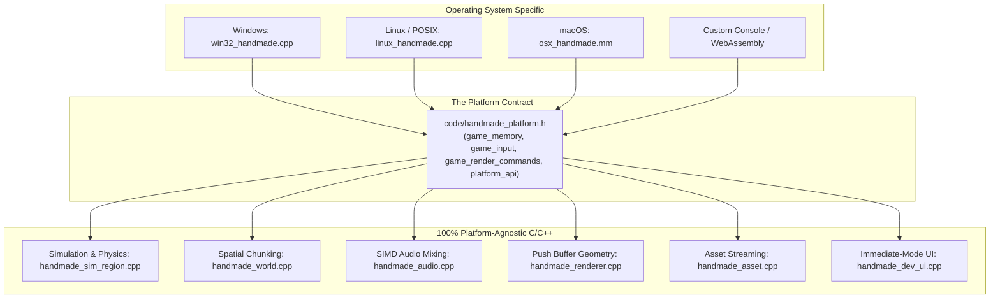

#### The Header Firewall Rule
There is one non-negotiable law governing this architecture:
> **The platform-independent game code must never include an OS header.**

If you see `#include <windows.h>` or `#include <unistd.h>` inside `handmade.cpp`, you have broken the architecture. By enforcing this header firewall:
1. **Compilation Speed**: The compiler never parses the massive, bloated Windows SDK header files ($>200{,}000$ lines of macros and typedefs) when compiling game code.
2. **Zero Platform Pollution**: Windows macros like `#define min(a,b)` or `#define max(a,b)` cannot collide with or corrupt your engine's math functions.
3. **Instant Portability**: Porting the entire game to a new operating system requires writing only **one file**: the platform host file. The other 100,000 lines of engine code do not change by a single character.

---

### The Functional Contract: `handmade_platform.h`

The boundary between the platform and the game engine is fundamentally bidirectional:
1. **Services the Platform provides to the Game** (OS capabilities exposed via function pointers in `platform_api`).
2. **Services the Game provides to the Platform** (exported functions called by the host loop).

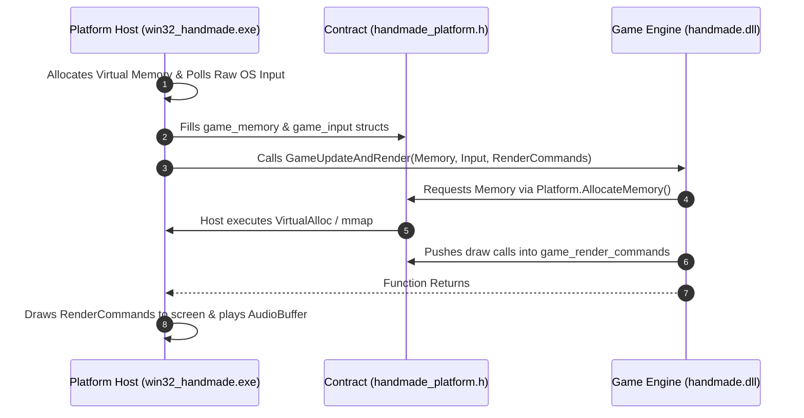

#### 1. Services Provided by the Game to the Platform
The game engine compiles as a dynamic library (`handmade.dll`) exporting only three functions:

```c
// 1. Frame update and render push buffer population
#define GAME_UPDATE_AND_RENDER(name) void name(game_memory *Memory, \
                                               game_input *Input, \
                                               game_render_commands *RenderCommands)
typedef GAME_UPDATE_AND_RENDER(game_update_and_render);

// 2. Audio mixing buffer fill
#define GAME_GET_SOUND_SAMPLES(name) void name(game_memory *Memory, \
                                               game_sound_output_buffer *SoundBuffer)
typedef GAME_GET_SOUND_SAMPLES(game_get_sound_samples);

// 3. Optional diagnostic frame collation hook
#define DEBUG_GAME_FRAME_END(name) void name(game_memory *Memory, \
                                             game_input *Input, \
                                             game_render_commands *RenderCommands)
typedef DEBUG_GAME_FRAME_END(debug_game_frame_end);
```

#### 2. Services Provided by the Platform to the Game: `platform_api`
In `code/handmade_platform.h`, the platform exposes low-level OS operations through a function table passed inside `game_memory`:

```c
typedef struct platform_api
{
    // Multi-threaded work queue dispatch
    platform_add_entry *AddEntry;
    platform_complete_all_work *CompleteAllWork;
    
    // File system operations (completely platform-independent handles)
    platform_get_all_files_of_type_begin *GetAllFilesOfTypeBegin;
    platform_get_all_files_of_type_end *GetAllFilesOfTypeEnd;
    platform_get_file_by_path *GetFileByPath;
    platform_open_file *OpenFile;
    platform_set_file_size *SetFileSize;
    platform_read_data_from_file *ReadDataFromFile;
    platform_write_data_to_file *WriteDataToFile;
    platform_atomic_replace_file_contents *AtomicReplaceFileContents;
    platform_close_file *CloseFile;
    
    // Raw OS virtual memory allocations
    platform_allocate_memory *AllocateMemory;
    platform_deallocate_memory *DeallocateMemory;
    
    // Error messaging
    platform_error_message *ErrorMessage;
} platform_api;

extern platform_api Platform;
```

---

### Data Ownership & The Opaque Pointer Pattern

Who owns the memory? **The platform layer owns the physical allocation, but the game layer owns the types.**

Look at how `game_memory` is defined in `code/handmade_platform.h`:

```c
typedef struct game_memory
{
    // Opaque forward declaration! The platform layer has NO IDEA what is inside game_state!
    struct game_state *GameState;
    
#if HANDMADE_INTERNAL
    struct debug_table *DebugTable;
    struct debug_state *DebugState;
#endif
    
    platform_work_queue *HighPriorityQueue;
    platform_work_queue *LowPriorityQueue;
    struct renderer_texture_queue *TextureQueue;
    
    b32 ExecutableReloaded;
    platform_api PlatformAPI;
} game_memory;
```

Notice `struct game_state *GameState;`. In `handmade_platform.h`, `game_state` is an **opaque forward declaration**. The platform layer (`win32_handmade.cpp`) never sees the internal members of `game_state`. It simply holds a pointer to a block of memory.

In `code/handmade.h`, the game engine defines the full struct:
```c
struct game_state
{
    memory_arena ModeArena;
    memory_arena AudioArena;
    
    controlled_hero ControlledHeroes[ArrayCount(((game_input *)0)->Controllers)];
    
    u32 DevMode;
    // ...
};
```

When the game DLL boots up for the first time, it initializes its internal structures inside the memory block provided by the platform:

```c
extern "C" GAME_UPDATE_AND_RENDER(GameUpdateAndRender)
{
    Platform = Memory->PlatformAPI;
    
    game_state *GameState = Memory->GameState;
    if(!GameState)
    {
        // First boot: Bootstrap the game_state out of physical memory!
        GameState = Memory->GameState = BootstrapPushStruct(game_state, ModeArena);
    }
    
    // Normal frame simulation...
}
```

This single architectural pattern is what enables **Live Hot Code Reloading**. Because `GameState` lives in memory allocated by the host process, you can recompile `handmade.dll`, unload the old DLL, load the new DLL, and resume execution without losing a single entity, variable, or position!

---

### Decoupling Input & Output

#### 1. Input Normalization (`game_input`)
The game engine never checks Windows Virtual Key codes (`VK_SPACE`) or XInput gamepad bitmasks (`XINPUT_GAMEPAD_A`). Instead, the platform polls raw hardware events, filters OS quirks, and populates a normalized `game_input` structure:

```c
typedef struct game_button_state
{
    int HalfTransitionCount; // Number of times button changed state this frame
    bool32 EndedDown;        // True if button ended the frame pressed down
} game_button_state;

typedef struct game_controller_input
{
    b32 IsConnected;
    b32 IsAnalog;
    
    // Fully normalized thumbstick coordinates (-1.0f to +1.0f) with deadzones resolved!
    f32 StickAverageX;
    f32 StickAverageY;
    
    union
    {
        game_button_state Buttons[12];
        struct
        {
            game_button_state MoveUp;
            game_button_state MoveDown;
            game_button_state MoveLeft;
            game_button_state MoveRight;
            
            game_button_state ActionUp;
            game_button_state ActionDown;
            game_button_state ActionLeft;
            game_button_state ActionRight;
            
            game_button_state LeftShoulder;
            game_button_state RightShoulder;
            game_button_state Back;
            game_button_state Start;
        };
    };
} game_controller_input;
```

#### 2. Rendering Decoupling: Push Buffers (`game_render_commands`)
The game engine never makes direct rendering calls (no `glDrawArrays`, no `Direct3D11DeviceContext->Draw`). The game simply populates a memory buffer with geometric commands (`game_render_commands`).

The platform host is free to consume that push buffer however it wants:
* On Windows, pass it to an OpenGL 3.3+ core profile renderer (`win32_handmade_opengl.cpp`).
* On another platform, pass it to Vulkan, Metal, or Direct3D 12.
* On a headless server or low-spec device, pass it to our custom multi-threaded software rasterizer (`handmade_renderer_software.cpp`).

---

### How Anyone Can Implement This Architecture in Their Codebase

Here is the exact, step-by-step practical blueprint for implementing this architecture in your own projects from scratch.

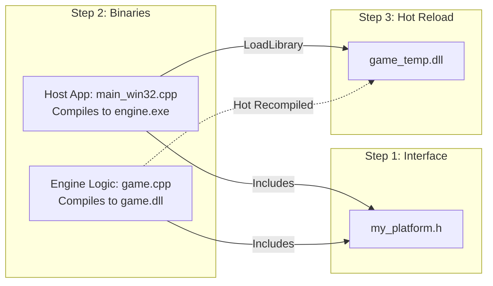

#### Step 1: Create the Platform Contract (`my_platform.h`)
Create a single header file containing only basic primitive types, memory structures, input representations, and function signatures:

```c
// my_platform.h
#if !defined(MY_PLATFORM_H)
#define MY_PLATFORM_H

#include <stdint.h>
typedef float    f32;
typedef int32_t  s32;
typedef uint32_t u32;
typedef uint64_t u64;
typedef s32      b32;

struct game_memory
{
    u64 PermanentStorageSize;
    void *PermanentStorage; // Pre-allocated by host
    
    u64 TransientStorageSize;
    void *TransientStorage; // Scratchpad memory
    
    b32 IsInitialized;
};

struct game_input
{
    f32 dtForFrame;
    f32 MoveX, MoveY;
    b32 ActionButton;
};

#define GAME_UPDATE_AND_RENDER(name) void name(game_memory *Memory, game_input *Input)
typedef GAME_UPDATE_AND_RENDER(game_update_and_render);

#endif
```

#### Step 2: Implement the Game DLL (`game.cpp`)
Write the game logic. It only includes `my_platform.h`:

```c
// game.cpp
#include "my_platform.h"

struct game_state
{
    f32 PlayerX;
    f32 PlayerY;
};

extern "C" __declspec(dllexport) GAME_UPDATE_AND_RENDER(GameUpdateAndRender)
{
    game_state *GameState = (game_state *)Memory->PermanentStorage;
    if(!Memory->IsInitialized)
    {
        GameState->PlayerX = 100.0f;
        GameState->PlayerY = 100.0f;
        Memory->IsInitialized = true;
    }
    
    // Simulate player movement
    GameState->PlayerX += Input->MoveX * 200.0f * Input->dtForFrame;
    GameState->PlayerY += Input->MoveY * 200.0f * Input->dtForFrame;
}
```

#### Step 3: Implement the Platform Host (`win32_main.cpp`)
The host process creates the window, allocates virtual memory, handles dynamic code loading, and drives the tick loop:

```c
// win32_main.cpp
#include <windows.h>
#include "my_platform.h"

struct win32_game_code
{
    HMODULE Library;
    FILETIME LastWriteTime;
    game_update_and_render *UpdateAndRender;
    b32 IsValid;
};

inline FILETIME Win32GetLastWriteTime(char *Path)
{
    FILETIME Result = {};
    WIN32_FILE_ATTRIBUTE_DATA Data;
    if(GetFileAttributesExA(Path, GetFileExInfoStandard, &Data))
    {
        Result = Data.ftLastWriteTime;
    }
    return(Result);
}

win32_game_code Win32LoadGameCode(char *SourceDLL, char *TempDLL)
{
    win32_game_code Result = {};
    Result.LastWriteTime = Win32GetLastWriteTime(SourceDLL);
    
    // CRITICAL: Copy game.dll to a temporary file before loading!
    // This allows the compiler to overwrite game.dll while the game is running!
    CopyFileA(SourceDLL, TempDLL, FALSE);
    
    Result.Library = LoadLibraryA(TempDLL);
    if(Result.Library)
    {
        Result.UpdateAndRender = (game_update_and_render *)
            GetProcAddress(Result.Library, "GameUpdateAndRender");
        Result.IsValid = (Result.UpdateAndRender != 0);
    }
    return(Result);
}

int CALLBACK WinMain(HINSTANCE Instance, HINSTANCE Prev, LPSTR Cmd, int Show)
{
    // 1. Allocate game memory once at startup
    game_memory Memory = {};
    Memory.PermanentStorageSize = 64 * 1024 * 1024; // 64 MB
    Memory.PermanentStorage = VirtualAlloc(0, Memory.PermanentStorageSize, 
                                           MEM_RESERVE|MEM_COMMIT, PAGE_READWRITE);

    // 2. Load game DLL dynamically
    win32_game_code GameCode = Win32LoadGameCode("game.dll", "game_temp.dll");

    b32 Running = true;
    while(Running)
    {
        // 3. Hot Reload Check
        FILETIME CurrentWriteTime = Win32GetLastWriteTime("game.dll");
        if(CompareFileTime(&CurrentWriteTime, &GameCode.LastWriteTime) != 0)
        {
            FreeLibrary(GameCode.Library);
            GameCode = Win32LoadGameCode("game.dll", "game_temp.dll");
        }

        // 4. Poll Windows Messages & Input
        MSG Message;
        while(PeekMessage(&Message, 0, 0, 0, PM_REMOVE))
        {
            if(Message.message == WM_QUIT) Running = false;
            TranslateMessage(&Message);
            DispatchMessageA(&Message);
        }

        game_input Input = {};
        Input.dtForFrame = 1.0f / 60.0f;
        // (Poll keyboard / controller here)

        // 5. Execute Game Tick
        if(GameCode.IsValid)
        {
            GameCode.UpdateAndRender(&Memory, &Input);
        }

        Sleep(16); // Sync to 60 FPS
    }
    return(0);
}
```

#### Step 4: Write the Compilation Script (`build.bat`)
```bat
@echo off
REM Compile game logic as DLL
cl -O2 -LD game.cpp /link -incremental:no -opt:ref -EXPORT:GameUpdateAndRender

REM Compile platform host executable
cl -O2 win32_main.cpp /link user32.lib
```

When you run `build.bat`, you will see your engine update its simulation logic in real time as you edit code, without ever closing the window or resetting memory.

---

### Debugging, Diagnostics & Profiling (Module 2)

#### 1. Header Leakage Verification
To ensure that your game layer remains 100% platform-independent and free of OS pollution:
* In `handmade.cpp`, deliberately add a test line:
  ```c
  HWND TestWindowHandle = 0; // Should trigger a compiler error!
  ```
  If the compiler successfully compiles this line without an error, **an OS header has leaked into your game codebase**! Trace your `#include` tree immediately and remove the offending header.

#### 2. Cross-Compiler ABI Verification
When sharing structs between a dynamic library (`.dll`) and a host executable (`.exe`), memory layout alignment must be identical. If the host compiler uses 8-byte alignment and the DLL compiler uses 4-byte alignment, struct members will be offset and memory corruption will occur!

* Always enforce explicit binary packing for boundary structs using compile-time assertions:
  ```c
  #pragma pack(push, 1)
  struct platform_file_info
  {
      u64 FileSize;
      u64 FileDate;
  };
  #pragma pack(pop)
  
  // Verify with compile-time assertions:
  CTAssert(sizeof(platform_file_info) == 16);
  ```

#### 3. Surviving Dynamic Reload Crashes
If you introduce a `NULL` pointer dereference in `game.cpp`, the host process will crash. To build an invincible development harness:
* Wrap the dynamic call to `GameCode.UpdateAndRender()` in a Windows Structured Exception Handling (SEH) block:
  ```c
  __try
  {
      GameCode.UpdateAndRender(&Memory, &Input, &RenderCommands);
  }
  __except(EXCEPTION_EXECUTE_HANDLER)
  {
      // Crash caught! Log error, reload previous stable DLL, and keep running!
      OutputDebugStringA("Game crashed! Waiting for code fix...\n");
  }
  ```
Your game engine will survive code crashes, allowing you to fix the bug in your text editor, recompile, and keep playing immediately!


---


# Module 3: Memory & Core Data Structures

In low-level engine programming, memory is not an abstract cloud where you casually allocate objects with `new` or `malloc`. Memory is physical silicon: rows of DRAM capacitors, governed by cache lines, pages, and CPU translation lookaside buffers (TLB). 

In this module, we construct the foundation of our entire engine: the **Memory Arena** subsystem (`handmade_memory.h`). We will learn why linear allocators are mathematically superior to free lists, how to guarantee byte alignment, how to enforce memory boundaries using CPU hardware page guards, and how to bootstrap complex state out of thin air.

### Architecture: Physical Layout of Memory Arenas

A Memory Arena is fundamentally a contiguous block of virtual memory with a base address (`Base`), a total capacity (`Size`), and a current allocation offset (`Used`). Every allocation is a simple pointer bump:

$$\text{Allocated Address} = \text{Base} + \text{Used} + \text{AlignmentOffset}$$

$$\text{New Used} = \text{Used} + \text{AllocationSize} + \text{AlignmentOffset}$$

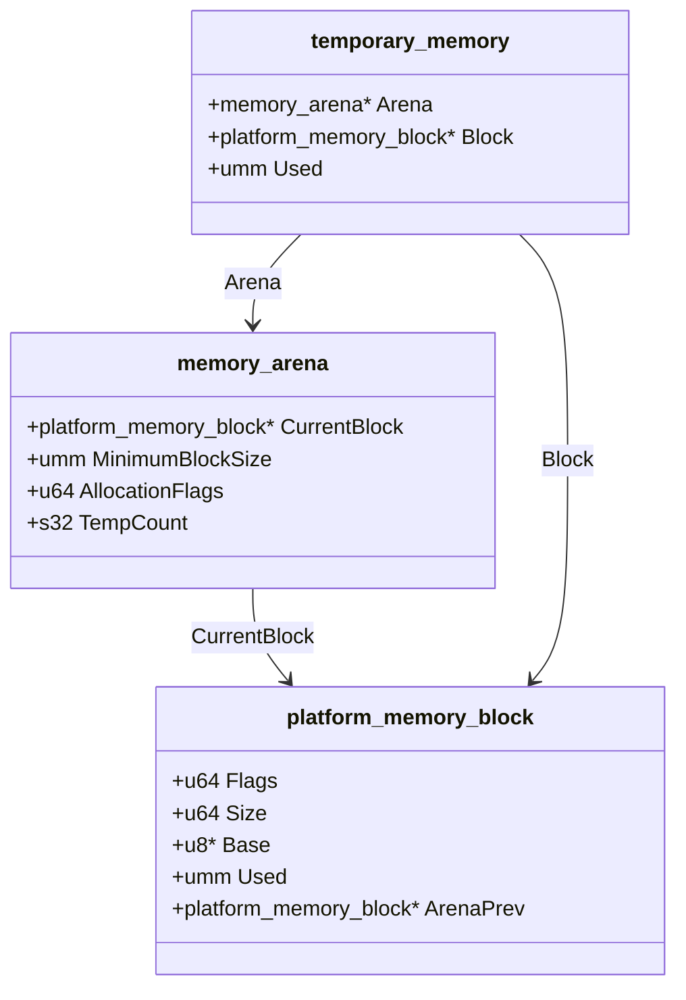

The memory layout of an active arena within physical memory resembles a structured linear tape:

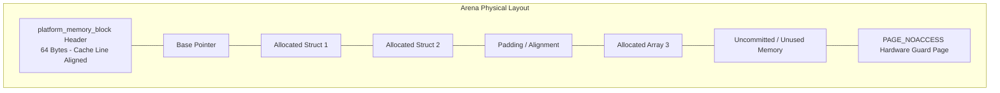

### Core Implementation: `handmade_memory.h`

Let us examine the foundational types and functions from `code/handmade_memory.h`. Every single line has a direct hardware consequence.

```c
#if !defined(HANDMADE_MEMORY_H)
/* ========================================================================
   $File: handmade_memory.h $
   $Date: 2026-11-02 $
   $Creator: Casey Muratori $
   ======================================================================== */

#define HANDMADE_MEMORY_H

/* NOTE: Zero Is Initialization (ZII) Paradigm:
   Memory arenas guarantee that memory is returned clean and zero-filled,
   eliminating the need for custom constructors and zero-out logic.
*/

struct memory_arena
{
    // Pointer to the active OS-allocated memory block
    platform_memory_block *CurrentBlock;
    
    // Minimum chunk size to allocate if CurrentBlock runs out of space
    umm MinimumBlockSize;
    
    // Allocation flags (e.g., overflow checking, underflow checking)
    u64 AllocationFlags;
    
    // Safety counter to ensure all temporary memory scopes are closed
    s32 TempCount;
};

struct temporary_memory
{
    memory_arena *Arena;
    platform_memory_block *Block;
    umm Used; // The watermark position at the time temporary memory began
};

// ------------------------------------------------------------------------
// Alignment & Offset Calculations
// ------------------------------------------------------------------------
inline memory_index
GetAlignmentOffset(memory_arena *Arena, memory_index Alignment)
{
    memory_index AlignmentOffset = 0;
    
    // Calculate current raw memory pointer
    memory_index ResultPointer = (memory_index)Arena->CurrentBlock->Base + Arena->CurrentBlock->Used;
    
    // Alignment MUST be a power of two: (Alignment - 1) creates a bitmask
    memory_index AlignmentMask = Alignment - 1;
    if(ResultPointer & AlignmentMask)
    {
        // Compute how many bytes we must skip forward to hit an aligned boundary
        AlignmentOffset = Alignment - (ResultPointer & AlignmentMask);
    }
    
    return(AlignmentOffset);
}

// ------------------------------------------------------------------------
// Arena Push Parameters
// ------------------------------------------------------------------------
enum arena_push_flag
{
    ArenaFlag_ClearToZero = 0x1,
};

struct arena_push_params
{
    u32 Flags;
    u32 Alignment;
};

inline arena_push_params
DefaultArenaParams(void)
{
    arena_push_params Params;
    Params.Flags = ArenaFlag_ClearToZero;
    Params.Alignment = 4; // Default to 4-byte (32-bit) alignment
    return(Params);
}

inline arena_push_params
AlignNoClear(u32 Alignment)
{
    arena_push_params Params = DefaultArenaParams();
    Params.Flags &= ~ArenaFlag_ClearToZero;
    Params.Alignment = Alignment;
    return(Params);
}

// ------------------------------------------------------------------------
// Primary Linear Allocation Routine: PushSize_
// ------------------------------------------------------------------------
inline void *
PushSize_(memory_arena *Arena, memory_index SizeInit, arena_push_params Params = DefaultArenaParams())
{
    void *Result = 0;
    
    // Enforce reasonable power-of-two alignment limits
    Assert(Params.Alignment <= 128);
    Assert(IsPow2(Params.Alignment));
    
    memory_index Size = 0;
    if(Arena->CurrentBlock)
    {
        // Determine total size including alignment padding
        Size = SizeInit + GetAlignmentOffset(Arena, Params.Alignment);
    }
    
    // If we have no block, or if the current block cannot fit the allocation:
    if(!Arena->CurrentBlock ||
       ((Arena->CurrentBlock->Used + Size) > Arena->CurrentBlock->Size))
    {
        Size = SizeInit;
        if(!Arena->MinimumBlockSize)
        {
            Arena->MinimumBlockSize = 1024 * 1024; // 1MB default block size
        }
        
        // Allocate a new block that is at least as large as the allocation request
        memory_index BlockSize = Maximum(Size, Arena->MinimumBlockSize);
        
        // Allocate physical pages directly from the platform abstraction layer
        platform_memory_block *NewBlock = Platform.AllocateMemory(BlockSize, Arena->AllocationFlags);
        NewBlock->ArenaPrev = Arena->CurrentBlock;
        Arena->CurrentBlock = NewBlock;
    }    
    
    Assert((Arena->CurrentBlock->Used + Size) <= Arena->CurrentBlock->Size);
    
    // Compute exact aligned pointer inside the block
    memory_index AlignmentOffset = GetAlignmentOffset(Arena, Params.Alignment);
    umm OffsetInBlock = Arena->CurrentBlock->Used + AlignmentOffset;
    Result = Arena->CurrentBlock->Base + OffsetInBlock;
    
    // Bump the allocation watermark
    Arena->CurrentBlock->Used += Size;
    
    // Enforce Zero-Is-Initialization if requested
    if(Params.Flags & ArenaFlag_ClearToZero)
    {
        ZeroSize(SizeInit, Result);
    }
    
    return(Result);
}

// ------------------------------------------------------------------------
// Ergonomic Allocation Macros
// ------------------------------------------------------------------------
#define PushStruct(Arena, type, ...) (type *)PushSize_(Arena, sizeof(type), ## __VA_ARGS__)
#define PushArray(Arena, Count, type, ...) (type *)PushSize_(Arena, (Count)*sizeof(type), ## __VA_ARGS__)
#define PushSize(Arena, Size, ...) PushSize_(Arena, Size, ## __VA_ARGS__)
```

### The Bootstrap Pattern: Creating Objects Out of Their Own Arenas

One of the most elegant architectural patterns in Handmade Hero is the **Bootstrap Allocation** (`BootstrapPushStruct`). 

Consider this design problem: you want a high-level subsystem (e.g., `world_mode` or `game_state`) to own its own `memory_arena`. But where does the memory for the `world_mode` struct itself come from? In standard C++, developers allocate the manager on the global heap and then initialize members.

In Handmade Hero, **a struct allocates itself out of its own internal arena**:

```c
#define OffsetOf(type, Member) (umm)&(((type *)0)->Member)

#define BootstrapPushStruct(type, Member, ...) \
    (type *)BootstrapPushSize_(sizeof(type), OffsetOf(type, Member), ## __VA_ARGS__)

inline void *
BootstrapPushSize_(umm StructSize, umm OffsetToArena,
                   arena_bootstrap_params BootstrapParams = DefaultBootstrapParams(), 
                   arena_push_params Params = DefaultArenaParams())
{
    // 1. Create a temporary, local stack arena
    memory_arena Bootstrap = {};
    Bootstrap.AllocationFlags = BootstrapParams.AllocationFlags;
    Bootstrap.MinimumBlockSize = BootstrapParams.MinimumBlockSize;
    
    // 2. Allocate the struct out of the bootstrap arena!
    // This triggers Platform.AllocateMemory() to back the bootstrap arena with real OS pages.
    void *Struct = PushSize_(&Bootstrap, StructSize, Params);
    
    // 3. Copy the initialized arena state directly into the member arena inside the struct!
    *(memory_arena *)((u8 *)Struct + OffsetToArena) = Bootstrap;
    
    return(Struct);
}
```

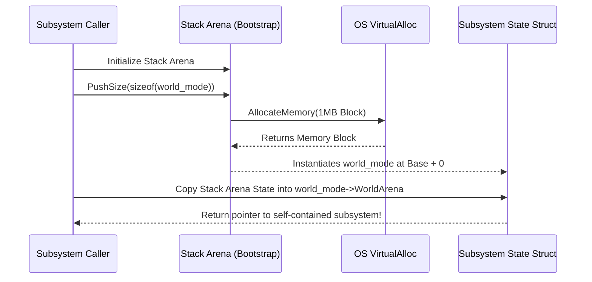

### Temporary Memory: Zero-Cost Stack Scoping

When a function needs temporary scratchpad memory (e.g., sorting an entity array, uncompressing an audio chunk, or constructing text strings), it does not call `malloc()` and `free()`. It captures a `temporary_memory` token:

```c
inline temporary_memory
BeginTemporaryMemory(memory_arena *Arena)
{
    temporary_memory Result;
    
    Result.Arena = Arena;
    Result.Block = Arena->CurrentBlock;
    // Record the current high-water mark of allocations
    Result.Used = Arena->CurrentBlock ? Arena->CurrentBlock->Used : 0;
    
    ++Arena->TempCount;
    return(Result);
}

inline void
EndTemporaryMemory(temporary_memory TempMem)
{
    memory_arena *Arena = TempMem.Arena;
    
    // Free any intermediate OS blocks allocated during the temporary scope
    while(Arena->CurrentBlock != TempMem.Block)
    {
        FreeLastBlock(Arena);
    }
    
    // Instantaneous rollback: restore previous allocation offset!
    if(Arena->CurrentBlock)
    {
        Assert(Arena->CurrentBlock->Used >= TempMem.Used);
        Arena->CurrentBlock->Used = TempMem.Used;
    }
    
    Assert(Arena->TempCount > 0);
    --Arena->TempCount;
}
```

This rollback is fundamentally instantaneous. Millions of bytes of scratch data can be reclaimed in a single assignment: `Arena->CurrentBlock->Used = TempMem.Used`.

---

### Debugging, Diagnostics & Profiling

#### Hardware Page Guards: Trapping Buffer Overflows
In `win32_handmade.cpp`, memory blocks can be allocated with `PlatformMemory_OverflowCheck` or `PlatformMemory_UnderflowCheck`:

```c
umm SizeRoundedUp = AlignPow2(Size, PageSize);
TotalSize = SizeRoundedUp + 2*PageSize;
BaseOffset = PageSize + SizeRoundedUp - Size;
ProtectOffset = PageSize + SizeRoundedUp;

win32_memory_block *Block = (win32_memory_block *)
    VirtualAlloc(0, TotalSize, MEM_RESERVE|MEM_COMMIT, PAGE_READWRITE);

// Place a hardware guard page immediately after the allocation boundary!
DWORD OldProtect = 0;
VirtualProtect((u8 *)Block + ProtectOffset, PageSize, PAGE_NOACCESS, &OldProtect);
```


* **Instant Bug Detection**: If an algorithm overshoots an array boundary by even a single byte, the CPU's Memory Management Unit (MMU) traps instantly on the `PAGE_NOACCESS` page, halting the debugger on the exact line of code responsible!

#### Memory Inspection via Debugger Commands
* **In Visual Studio / WinDbg**: Use `!address <pointer>` to inspect the virtual page protection and allocation state.
* **In RemedyBG**: Set an **Access Watchpoint** (hardware memory breakpoint) on `Arena->CurrentBlock->Used`. Any unexpected allocation or out-of-order write will immediately break execution.
* **Valgrind Memcheck (Linux)**: Under `linux_handmade.cpp`, run:
  ```bash
  valgrind --tool=memcheck --leak-check=full ./handmade_hero
  ```
  Because memory arenas use standard large page requests, Valgrind will report zero leaks because all blocks remain anchored in the `platform_memory_block` linked list.


---


# Module 4: High-Performance Multi-Threading from First Principles

Writing multi-threaded code in modern software engineering is notoriously error-prone. The typical C++ approach—instantiating `std::thread`, locking `std::mutex`, waiting on `std::condition_variable`, and building a "thread per subsystem" architecture (one thread for Audio, one thread for Physics, one thread for AI)—is one of the slowest, most brittle concurrency designs ever conceived.

In this module, we construct the **Handmade Hero Multi-Threading Architecture** from first principles (`code/win32_handmade.cpp`, `code/handmade_platform.h`, `code/handmade_types.h`). We will learn why traditional threading fails, how to build a lock-free atomic **Work Queue**, how the **Ticket Mutex** guarantees strict FIFO fairness without kernel overhead, and how to parallelize real-world game workloads like screen-tile software rasterization, asynchronous asset streaming, and voxel raycasting.

---

### Why Traditional Multi-Threading Fails in Game Engines

Before writing a single line of concurrent code, you must understand what modern hardware does when threads collide:

```mermaid
flowchart TD
    subgraph The Anti-Pattern: Thread-per-Subsystem
        T_PHYS[Physics Thread: 100% Core 0 Load] -->|Waits on| T_AI[AI Thread: Stalled on Core 1]
        T_AI -->|Locks Mutex| T_REND[Render Thread: Blocked on Core 2]
        T_REND --> CONTEXT[OS Kernel Context Switch: 2000-5000 Cycles Lost!]
    end

    subgraph The Handmade Paradigm: Work Queue Job System
        POOL[Pool of N Worker Threads = N Hardware Cores]
        JOBS[Independent Work Queue: Small, Cache-Sized Jobs]
        POOL -->|Atomic Claim & Execute| JOBS
        JOBS -->|100% Balanced Multi-Core Utilization| HARDWARE[All Cores Active - Zero OS Context Switches]
    end
```

#### The Four Fatal Flaws of Traditional Threading:
1. **The Subsystem Workload Imbalance**: Subsystems do not have identical workloads. Physics might take 14ms on a heavy frame while AI takes 1ms. If each lives on a dedicated thread, Core 1 sits idle 90% of the time while Core 0 chokes and drops frames.
2. **The Staggering Cost of OS Context Switches**: When an OS mutex (`CRITICAL_SECTION`, `std::mutex`) blocks, the OS kernel unschedules the thread. A thread context switch costs between **2,000 and 5,000 CPU clock cycles**—plus it evicts your hot data from the L1/L2 CPU caches!
3. **Priority Inversion & Deadlocks**: Complex mutex locking hierarchies inevitably create circular wait chains (deadlocks) and priority inversions (low-priority background threads holding locks needed by the main 60 FPS thread).
4. **Cache Line Ping-Ponging (False Sharing)**: If two threads write to different variables that happen to live on the same 64-byte cache line, the CPU cache-coherency bus (MESI protocol) repeatedly invalidates and re-transmits the cache line between core caches, stalling memory throughput.

---

### The Work Queue Architecture: `platform_work_queue`

In Handmade Hero, we do not assign tasks to specific threads. Instead, we create a pool of persistent worker threads matching the machine's physical core count. We feed them via a centralized, lock-free **Work Queue** (`platform_work_queue`).

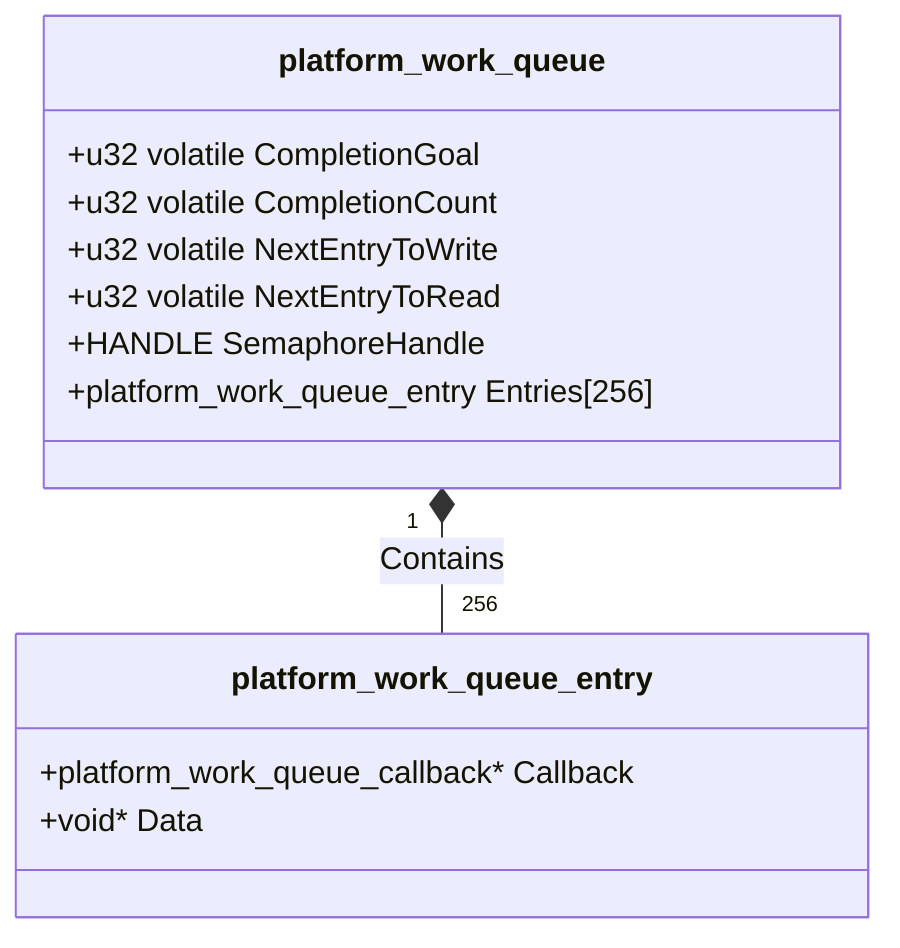

Let us inspect the data structure from `code/win32_handmade.h`:

```c
struct platform_work_queue_entry
{
    platform_work_queue_callback *Callback; // Function pointer: void Callback(Queue, Data)
    void *Data;                             // Pointer to work-specific parameters
};

struct platform_work_queue
{
    // High-water markers for completion tracking
    u32 volatile CompletionGoal;
    u32 volatile CompletionCount;
    
    // Circular ring buffer write and read indices
    u32 volatile NextEntryToWrite;
    u32 volatile NextEntryToRead;
    
    // OS Semaphore handle used to sleep worker threads when no work is pending
    HANDLE SemaphoreHandle;
    
    // Fixed circular array of 256 work entries
    platform_work_queue_entry Entries[256];
};
```

---

### Low-Level Synchronization Primitives

#### 1. Lock-Free Work Extraction (`Win32DoNextWorkQueueEntry`)
When a worker thread is running, it extracts tasks from the circular queue using `InterlockedCompareExchange` (the atomic Compare-and-Swap, or CAS, opcode):

```c
internal bool32
Win32DoNextWorkQueueEntry(platform_work_queue *Queue)
{
    bool32 WeShouldSleep = false;
    
    // Read the current read index
    uint32 OriginalNextEntryToRead = Queue->NextEntryToRead;
    uint32 NewNextEntryToRead = (OriginalNextEntryToRead + 1) % ArrayCount(Queue->Entries);
    
    // If there is work remaining between NextEntryToRead and NextEntryToWrite:
    if(OriginalNextEntryToRead != Queue->NextEntryToWrite)
    {
        // ATOMIC COMPARE-AND-SWAP (CAS):
        // If Queue->NextEntryToRead STILL equals OriginalNextEntryToRead,
        // atomically set it to NewNextEntryToRead and return OriginalNextEntryToRead.
        // If another thread claimed it first, CAS fails and returns the new value!
        uint32 Index = InterlockedCompareExchange((LONG volatile *)&Queue->NextEntryToRead,
                                                  NewNextEntryToRead,
                                                  OriginalNextEntryToRead);
        if(Index == OriginalNextEntryToRead)
        {
            // SUCCESS! We own this work entry. Execute the callback:
            platform_work_queue_entry Entry = Queue->Entries[Index];
            Entry.Callback(Queue, Entry.Data);
            
            // Atomically report task completion
            InterlockedIncrement((LONG volatile *)&Queue->CompletionCount);
        }
    }
    else
    {
        // Queue is completely empty - worker should go to sleep
        WeShouldSleep = true;
    }
    
    return(WeShouldSleep);
}
```

#### 2. Zero-CPU Sleeping via Win32 Semaphores (`ThreadProc`)
If the queue is empty, worker threads must not burn 100% of the CPU spinning in an idle loop. We put them into an efficient kernel sleep state using a **Win32 Semaphore**:

```c
DWORD WINAPI
ThreadProc(LPVOID lpParameter)
{
    win32_thread_startup *Thread = (win32_thread_startup *)lpParameter;
    platform_work_queue *Queue = Thread->Queue;
    
    for(;;)
    {
        // Try to do work: if no work exists, Win32DoNextWorkQueueEntry returns true!
        if(Win32DoNextWorkQueueEntry(Queue))
        {
            // Put thread to sleep until ReleaseSemaphore is called.
            // Consumes ZERO CPU cycles while waiting!
            WaitForSingleObjectEx(Queue->SemaphoreHandle, INFINITE, FALSE);
        }
    }
}
```

#### 3. Waking Sleeping Workers (`Win32AddEntry`)
When the main thread pushes a job into the queue, it advances `NextEntryToWrite`, enforces a compiler write barrier, and signals the semaphore:

```c
internal void
Win32AddEntry(platform_work_queue *Queue, platform_work_queue_callback *Callback, void *Data)
{
    uint32 NewNextEntryToWrite = (Queue->NextEntryToWrite + 1) % ArrayCount(Queue->Entries);
    Assert(NewNextEntryToWrite != Queue->NextEntryToRead);
    
    platform_work_queue_entry *Entry = Queue->Entries + Queue->NextEntryToWrite;
    Entry->Callback = Callback;
    Entry->Data = Data;
    ++Queue->CompletionGoal;
    
    // Prevent the compiler from reordering writes past this point!
    _WriteBarrier();
    
    Queue->NextEntryToWrite = NewNextEntryToWrite;
    
    // Release 1 token on the semaphore, immediately waking 1 sleeping worker thread!
    ReleaseSemaphore(Queue->SemaphoreHandle, 1, 0);
}
```

#### 4. Cooperative Work Completion (`Win32CompleteAllWork`)
What happens when the main thread needs all background jobs finished before moving to the next frame stage (e.g., waiting for all screen tiles to finish rendering)?

In bad engines, the main thread calls `WaitForMultipleObjects` and sleeps. **In Handmade Hero, the main thread joins the worker pool**:

```c
internal void
Win32CompleteAllWork(platform_work_queue *Queue)
{
    // While work remains uncompleted:
    while(Queue->CompletionGoal != Queue->CompletionCount)
    {
        // DO NOT SLEEP! The main thread actively executes queue jobs itself!
        Win32DoNextWorkQueueEntry(Queue);
    }
    
    Queue->CompletionGoal = 0;
    Queue->CompletionCount = 0;
}
```
This is **work-stealing cooperative execution**: zero CPU cycles are wasted waiting for other cores.

---

### The Ticket Mutex: Perfect FIFO Fairness

When multiple threads must serialize access to a shared resource (such as reserving memory blocks from the OS in `Win32AllocateMemory`), standard spinlocks can cause **thread starvation** (one thread loops forever while other threads repeatedly grab the lock).

In `code/handmade_types.h`, Casey implements the **Ticket Mutex** (based on the classic bakery/deli counter algorithm):

```c
struct ticket_mutex
{
    u64 volatile Ticket;
    u64 volatile Serving;
};

inline void
BeginTicketMutex(ticket_mutex *Mutex)
{
    // Step 1: Pull a unique numbered ticket by atomically incrementing Ticket
    u64 Ticket = AtomicAddU64(&Mutex->Ticket, 1);
    
    // Step 2: Spin wait until the "Now Serving" counter matches our ticket number!
    while(Ticket != Mutex->Serving)
    {
        // The x86 PAUSE instruction:
        // 1. Relieves pipeline thrashing on hyper-threaded cores
        // 2. Reduces CPU power consumption during the spin loop
        _mm_pause();
    }
}

inline void
EndTicketMutex(ticket_mutex *Mutex)
{
    // Step 3: Advance the "Now Serving" counter by 1, granting access to the next ticket!
    AtomicAddU64(&Mutex->Serving, 1);
}
```

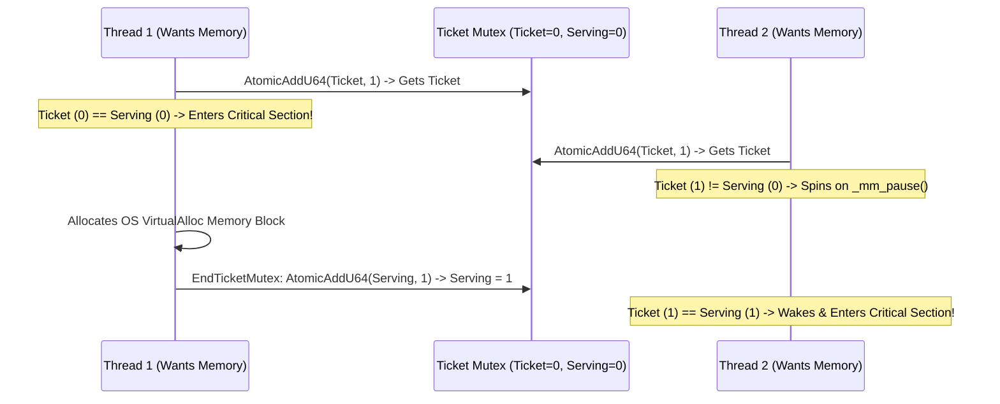

#### Why the Ticket Mutex Is Superior:
1. **Guaranteed FIFO Order**: Threads are serviced strictly in the chronological order they arrived. Starvation is mathematically impossible.
2. **Zero OS Overhead**: Stays entirely in user mode; never makes an expensive Windows kernel transition.
3. **Hyper-Threading Friendly**: `_mm_pause()` signals to the Intel/AMD hardware thread scheduler that this core is spinning, giving execution pipeline priority to sibling threads sharing the same physical execution units!

---

### Production Workloads in Handmade Hero

Let us examine how this multi-threading architecture powers the core engine:

#### 1. Multi-Threaded Tiled Software Rasterization
In `code/handmade_renderer_software.cpp`, software rendering is divided into rectangular screen tiles:

```c
// Enforce 4-pixel width alignment for SSE SIMD processing
TileWidth = ((TileWidth + 3) / 4) * 4;

int WorkCount = 0;
for(int TileY = 0; TileY < TileCountY; ++TileY)
{
    for(int TileX = 0; TileX < TileCountX; ++TileX)
    {
        tile_render_work *Work = WorkArray + WorkCount++;
        
        // Compute discrete, non-overlapping screen rectangle
        Work->ClipRect.MinX = TileX * TileWidth;
        Work->ClipRect.MaxX = Work->ClipRect.MinX + TileWidth;
        Work->ClipRect.MinY = TileY * TileHeight;
        Work->ClipRect.MaxY = Work->ClipRect.MinY + TileHeight;
        
        Work->Commands = Commands;
        Work->RenderTargets = RenderTargets;
        
        // Dispatch each tile to the background worker pool!
        Platform.AddEntry(RenderQueue, DoTiledRenderWork, Work);
    }
}
// Main thread helps render tiles until all are completed!
Platform.CompleteAllWork(RenderQueue);
```
Because every tile renders to a completely isolated rectangular buffer in memory, **there are zero mutexes, zero atomic locks, and zero write collisions during pixel rasterization**.

#### 2. Dual-Priority Queues: `HighPriorityQueue` vs. `LowPriorityQueue`
In `code/win32_handmade.cpp`, the platform layer initializes two distinct work queues:
* **`HighPriorityQueue` (6 Threads)**: Bound to game-critical, frame-blocking workloads (software rasterizer tiles, physics broadphase simulation, lighting ray propagation).
* **`LowPriorityQueue` (2 Threads)**: Bound to background streaming (reading `.HHA` asset bitmaps and audio chunks from disk).

If asset streaming takes 50 milliseconds to read a massive background texture from an SSD, it runs on `LowPriorityQueue` without stealing CPU time or stalling the 60 FPS rendering on `HighPriorityQueue`!

---

### Debugging, Diagnostics & Profiling

#### Visualizing Multi-Threaded Concurrency
In the in-game developer UI (`DevMode_profiling`), switch to the **Thread Interval Graph**:

```text
Core 0 (Main):    |== Frame Begin ==|                |== CompleteAllWork ==|== Swap ==|
Core 1 (Worker):         |== Tile 0 ==|== Tile 4 ==|== Tile 8 ==|
Core 2 (Worker):         |== Tile 1 ==|== Tile 5 ==|== Tile 9 ==|
Core 3 (Worker):         |== Tile 2 ==|== Tile 6 ==|
Core 4 (Worker):         |== Tile 3 ==|== Tile 7 ==|
```

* **Identifying Pipeline Bubbles**: If Core 3 and Core 4 finish early and sit idle while Core 1 is still rendering Tile 8, your tile sizes are too large! Split the screen into smaller tiles ($64 \times 64$ instead of $256 \times 256$) to achieve perfect load balancing across all cores.
* **Catching False Sharing**: If the profiler shows that execution slows down when multiple threads are active despite having no locks, inspect your data structs. Ensure that structs written by different threads are aligned to **64-byte boundaries** (`__declspec(align(64))`) so they never share the same L1 cache line!


---


# Module 5: Subsystem Implementation (Step-by-Step)

With our build pipeline and memory architecture firmly established, we now build the core engines of Handmade Hero. We group the source files into seven specialized subsystems:
1. **Math & SIMD Intrinsics**: Vector math, SSE 4-wide registers, and chunked high-precision coordinate spaces.
2. **Platform Abstraction & Hot Code Reloading**: The OS host, dynamic library hot-swapping, and audio/input polling.
3. **High-Performance Multi-Threaded Work Queue**: Lock-free work dispatching and core synchronization.
4. **Rendering Pipeline**: Software SIMD rasterization and modern OpenGL geometry batching.
5. **Entity System & Spatial Partitioning**: World chunk hashing and simulation region packing/unpacking.
6. **Audio Mixing Engine**: SIMD-accelerated 4-sample stereo mixing and volume ramping.
7. **Asset Streaming & File Formats**: Tag-based asset matching and asynchronous background streaming.

---

### Subsystem 5.1: Math, SIMD Intrinsics & Coordinate Systems
`handmade_math.h`, `handmade_simd.h`, `handmade_intrinsics.h`

#### Vector Mathematics & Bitwise Intrinsics
Game engines live and die by linear algebra. In `handmade_math.h`, we construct 2D, 3D, and 4D vectors (`v2`, `v3`, `v4`), $4 \times 4$ matrices (`m4x4`), and bounding rectangles (`rectangle2`, `rectangle3`). 

Notice our union definition for vectors:
```c
union v3
{
    struct { f32 x, y, z; };
    struct { f32 u, v, w; };
    struct { f32 r, g, b; };
    struct { v2 xy; f32 Ignored0_; };
    struct { f32 Ignored1_; v2 yz; };
    f32 E[3];
};
```
Thanks to warning suppression `-wd4201`, we can access elements interchangeably as spatial coordinates (`P.x`, `P.y`), texture UVs (`P.u`, `P.v`), color channels (`P.r`, `P.g`), or sub-vectors (`P.xy`) without a single byte of memory overhead or conversion functions!

Now examine `handmade_intrinsics.h`. Standard library functions like `abs()` or `sqrt()` involve function call overhead and branch mispredictions. We replace them with direct CPU intrinsics:

```c
inline f32
SquareRoot(f32 Real32)
{
    // Single-precision scalar square root instruction (SQRTSS)
    f32 Result = _mm_cvtss_f32(_mm_sqrt_ss(_mm_set_ss(Real32)));
    return(Result);
}

inline f32
SignOf(f32 Value)
{
    // Extract sign bit via bitwise AND with floating-point mask (1 << 31)
    // and bitwise OR with 1.0f. ZERO branch instructions!
    u32 MaskU32 = (u32)(1 << 31);
    __m128 Mask = _mm_set_ss(*(float *)&MaskU32);

    __m128 One = _mm_set_ss(1.0f);
    __m128 SignBit = _mm_and_ps(_mm_set_ss(Value), Mask);
    __m128 Combined = _mm_or_ps(One, SignBit);

    f32 Result = _mm_cvtss_f32(Combined);
    return(Result);
}
```

#### SIMD 4-Wide Packing (`handmade_simd.h`)
To process four 32-bit floats simultaneously, we define wide vector structures mapping directly to 128-bit SSE registers:

```c
struct f32_4x
{
    union
    {
        __m128 P;
        f32 E[4];
        u32 U32[4];
    };
};

struct v3_4x
{
    union
    {
        struct { f32_4x x, y, z; };
        struct { f32_4x r, g, b; };
        f32_4x E[3];
    };
};

inline v3_4x
operator+(v3_4x A, v3_4x B)
{
    v3_4x Result;
    // Execute three vector additions, each processing 4 independent lanes!
    Result.x.P = _mm_add_ps(A.x.P, B.x.P);
    Result.y.P = _mm_add_ps(A.y.P, B.y.P);
    Result.z.P = _mm_add_ps(A.z.P, B.z.P);
    return(Result);
}
```

#### Preserving Coordinate Precision: The Chunked World Coordinate System
A standard single-precision floating-point number (`f32`) has 24 bits of mantissa precision—roughly 7 decimal digits. If your game world is 10 kilometers wide and you measure positions in meters, as you travel away from the origin $(0, 0)$, the distance between representable floating-point numbers increases. At large coordinates, objects visibly stutter and physics calculations collapse due to floating-point rounding errors.

Handmade Hero solves this permanently with **Chunked World Positions** (`world_position`):

```c
struct world_position
{
    // Discrete 32-bit integer chunk indices
    s32 ChunkX;
    s32 ChunkY;
    s32 ChunkZ;
    
    // High-precision floating-point offset from the chunk center
    v3 Offset_;
};
```

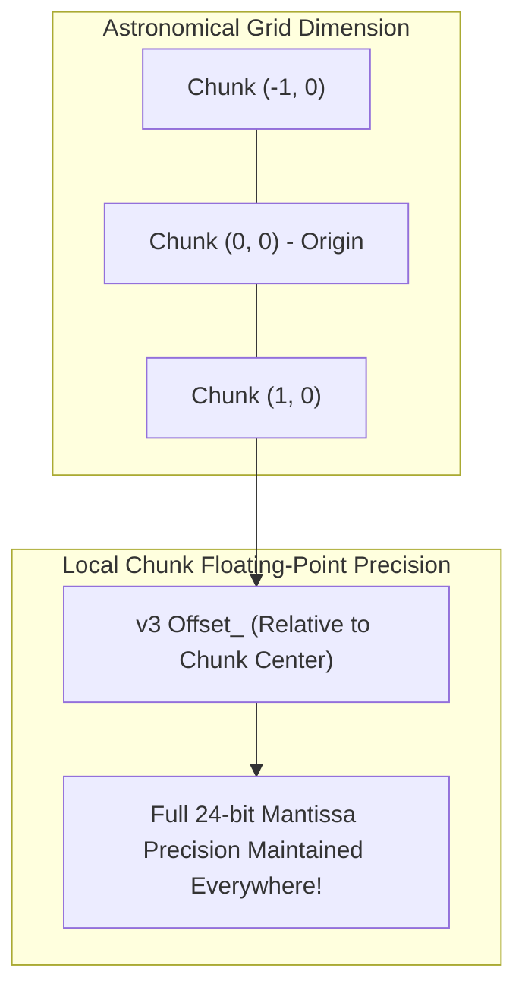

Whenever an entity moves so that `Offset_.x > ChunkDim.x * 0.5f`, we execute **Canonicalization**:
1. Increment `ChunkX` by 1.
2. Subtract `ChunkDim.x` from `Offset_.x`.
The floating-point offset never grows large enough to lose precision. Our game world can span billions of meters with sub-millimeter precision!

---

### Subsystem 5.2: Platform Abstraction & Hot Code Reloading
`handmade_platform.h`, `win32_handmade.cpp`, `win32_handmade.h`

#### The Platform Contract
The game layer exposes only three functions to the platform:
1. `GameUpdateAndRender`: Simulates the world and populates the render command stream.
2. `GameGetSoundSamples`: Mixes audio directly into the platform sound buffer.
3. `DEBUGGameFrameEnd`: Developer-only profiling hook.

The platform layer passes state in via `game_memory`:

```c
typedef struct game_memory
{
    struct game_state *GameState;
    
#if HANDMADE_INTERNAL
    struct debug_table *DebugTable;
    struct debug_state *DebugState;
#endif
    
    platform_work_queue *HighPriorityQueue;
    platform_work_queue *LowPriorityQueue;
    struct renderer_texture_queue *TextureQueue;
    
    b32 ExecutableReloaded;
    platform_api PlatformAPI;
} game_memory;
```

#### The Hot Reload Implementation: `Win32LoadCode`
In `win32_handmade.cpp`, the platform monitors the last write time of `handmade.dll`. When a change is detected, it hot-reloads the game logic dynamically:

```c
internal void
Win32LoadCode(win32_state *State, win32_loaded_code *Loaded)
{
    char *SourceDLLName = Loaded->DLLFullPath;
    char *LockFileName = Loaded->LockFullPath;
    char TempDLLName[WIN32_STATE_FILE_NAME_COUNT];
    
    WIN32_FILE_ATTRIBUTE_DATA Ignored;
    // Step 1: Ensure lock.tmp does not exist (meaning compilation finished)
    if(!GetFileAttributesExA(LockFileName, GetFileExInfoStandard, &Ignored))
    {
        Loaded->DLLLastWriteTime = Win32GetLastWriteTime(SourceDLLName);
        
        // Step 2: Copy handmade.dll to a uniquely numbered temporary file
        // This prevents the host process from locking handmade.dll on disk!
        Win32BuildEXEPathFileName(State, Loaded->TransientDLLName, Loaded->TempDLLNumber,
                                  sizeof(TempDLLName), TempDLLName);
        ++Loaded->TempDLLNumber;
        CopyFile(SourceDLLName, TempDLLName, FALSE);
        
        // Step 3: Load the transient DLL
        Loaded->DLL = LoadLibraryA(TempDLLName);
        if(Loaded->DLL)
        {
            Loaded->IsValid = true;
            // Step 4: Dynamically bind all exported game function pointers
            for(u32 FunctionIndex = 0; FunctionIndex < Loaded->FunctionCount; ++FunctionIndex)
            {
                void *Function = GetProcAddress(Loaded->DLL, Loaded->FunctionNames[FunctionIndex]);
                if(Function)
                {
                    Loaded->Functions[FunctionIndex] = Function;
                }
                else
                {
                    Loaded->IsValid = false;
                }
            }
        }
    }
}
```

---

### Subsystem 5.3: High-Performance Multi-Threaded Work Queue
`win32_handmade.cpp`, `handmade_platform.h`

Modern CPUs feature 8, 16, or 64 cores. If your game loop runs on a single thread, 90% of the hardware sits idle. 

We implement a lock-free, multi-threaded **Work Queue** (`platform_work_queue`) using atomic instructions (`InterlockedCompareExchange`) and OS Semaphores:

```c
struct platform_work_queue_entry
{
    platform_work_queue_callback *Callback;
    void *Data;
};

struct platform_work_queue
{
    u32 volatile CompletionGoal;
    u32 volatile CompletionCount;
    u32 volatile NextEntryToWrite;
    u32 volatile NextEntryToRead;
    HANDLE SemaphoreHandle;
    
    platform_work_queue_entry Entries[256];
};
```

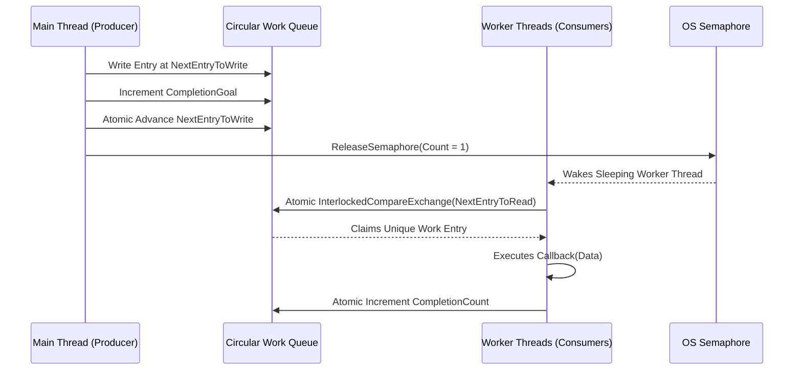

#### Lock-Free Queue Extraction:
```c
internal bool32
Win32DoNextWorkQueueEntry(platform_work_queue *Queue)
{
    bool32 WeShouldSleep = false;
    
    uint32 OriginalNextEntryToRead = Queue->NextEntryToRead;
    uint32 NewNextEntryToRead = (OriginalNextEntryToRead + 1) % ArrayCount(Queue->Entries);
    
    // Check if there is work remaining in the circular queue
    if(OriginalNextEntryToRead != Queue->NextEntryToWrite)
    {
        // ATOMIC COMPARE AND SWAP:
        // Attempt to claim this entry. If another thread claimed it first, CAS fails gracefully!
        uint32 Index = InterlockedCompareExchange((LONG volatile *)&Queue->NextEntryToRead,
                                                  NewNextEntryToRead,
                                                  OriginalNextEntryToRead);
        if(Index == OriginalNextEntryToRead)
        {
            // We own this entry! Execute the workload function
            platform_work_queue_entry Entry = Queue->Entries[Index];
            Entry.Callback(Queue, Entry.Data);
            
            // Mark task as completed
            InterlockedIncrement((LONG volatile *)&Queue->CompletionCount);
        }
    }
    else
    {
        WeShouldSleep = true;
    }
    
    return(WeShouldSleep);
}
```

---

### Subsystem 5.4: Rendering Pipeline - Software Rasterizer & Hardware OpenGL
`handmade_renderer.h`, `handmade_renderer.cpp`, `handmade_renderer_software.cpp`, `handmade_renderer_opengl.cpp`

#### The Push Buffer Command Architecture
The game engine never makes direct rendering API calls. Instead, it populates a linear memory stream called a **Push Buffer** (`game_render_commands`):

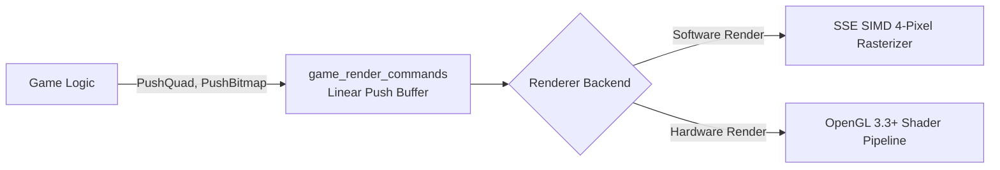

#### The Software Rasterizer: 4-Pixel Parallel SIMD Alpha Blending
Look at `code/handmade_renderer_software.cpp`. Casey implements a complete, perspective-correct software rasterizer that blends four 32-bit RGBA pixels simultaneously using SSE intrinsics:

```c
// Process 4 pixels in parallel (128-bit SIMD registers)
__m128 Inv255_4x = _mm_set1_ps(1.0f / 255.0f);
__m128 One = _mm_set1_ps(1.0f);
__m128 Colorr_4x = _mm_set1_ps(Color.r);
__m128 Colorg_4x = _mm_set1_ps(Color.g);
__m128 Colorb_4x = _mm_set1_ps(Color.b);
__m128 Colora_4x = _mm_set1_ps(Color.a);

// Unpack destination pixels from memory (BB GG RR AA)
__m128 DestR = _mm_cvtepi32_ps(_mm_and_si128(_mm_srli_epi32(DestPixel, 16), MaskFF));
__m128 DestG = _mm_cvtepi32_ps(_mm_and_si128(_mm_srli_epi32(DestPixel, 8), MaskFF));
__m128 DestB = _mm_cvtepi32_ps(_mm_and_si128(DestPixel, MaskFF));
__m128 DestA = _mm_cvtepi32_ps(_mm_and_si128(_mm_srli_epi32(DestPixel, 24), MaskFF));

// Convert from non-linear sRGB to Linear space for correct physical light blending:
DestR = _mm_mul_ps(DestR, DestR);
DestG = _mm_mul_ps(DestG, DestG);
DestB = _mm_mul_ps(DestB, DestB);

// Alpha Blending Formula: Result = (1 - Alpha)*Dest + Alpha*Source
__m128 InvAlpha = _mm_sub_ps(One, Colora_4x);
__m128 BlendedR = _mm_add_ps(_mm_mul_ps(InvAlpha, DestR), _mm_mul_ps(Colora_4x, Colorr_4x));
__m128 BlendedG = _mm_add_ps(_mm_mul_ps(InvAlpha, DestG), _mm_mul_ps(Colora_4x, Colorg_4x));
__m128 BlendedB = _mm_add_ps(_mm_mul_ps(InvAlpha, DestB), _mm_mul_ps(Colora_4x, Colorb_4x));

// Convert back from Linear space to sRGB via fast square root:
BlendedR = _mm_sqrt_ps(BlendedR);
BlendedG = _mm_sqrt_ps(BlendedG);
BlendedB = _mm_sqrt_ps(BlendedB);
```
This is real graphics programming: handling exact gamma curve conversion (`sRGB \leftrightarrow \text{Linear}`) directly on CPU vector registers!

---

### Subsystem 5.5: Entity System, Simulation Regions & Spatial Chunking
`handmade_world.h`, `handmade_world.cpp`, `handmade_sim_region.h`, `handmade_sim_region.cpp`

A game world may contain 100,000 entities, but simulating all 100,000 every frame is impossible. We must partition space.

#### The Chunk Hash Table
The world is divided into discrete chunks stored in a sparse hash table (`world->ChunkHash[4096]`):

```c
inline world_chunk *
GetWorldChunk(world *World, s32 ChunkX, s32 ChunkY, s32 ChunkZ, memory_arena *Arena = 0)
{
    // Fast hash function: mix chunk coordinates using prime multipliers
    u32 HashValue = 19*ChunkX + 7*ChunkY + 3*ChunkZ;
    u32 HashSlot = HashValue & (ArrayCount(World->ChunkHash) - 1);
    
    world_chunk *Chunk = World->ChunkHash[HashSlot];
    while(Chunk)
    {
        if((ChunkX == Chunk->ChunkX) &&
           (ChunkY == Chunk->ChunkY) &&
           (ChunkZ == Chunk->ChunkZ))
        {
            break;
        }
        Chunk = Chunk->NextInHash;
    }
    
    // If chunk does not exist and an arena was provided, allocate it!
    if(!Chunk && Arena)
    {
        Chunk = PushStruct(Arena, world_chunk);
        Chunk->ChunkX = ChunkX;
        Chunk->ChunkY = ChunkY;
        Chunk->ChunkZ = ChunkZ;
        Chunk->NextInHash = World->ChunkHash[HashSlot];
        World->ChunkHash[HashSlot] = Chunk;
    }
    
    return(Chunk);
}
```

#### Simulation Region Unpacking & Packing
When updating the camera, we define an active bounding box: the **Simulation Region** (`sim_region`).
1. **Unpack**: All entities inside chunks intersecting the simulation box are deserialized from their sparse `world_chunk` blocks into a dense, contiguous array of `sim_entity` structures. Their positions are translated into local coordinates relative to the simulation center.
2. **Simulate**: Physics, collision detection, brain AI, and movement are processed at maximum memory bandwidth across the dense array.
3. **Pack**: Once simulated, entities that moved outside their original chunks are re-hashed and written back into their new `world_chunk` locations.

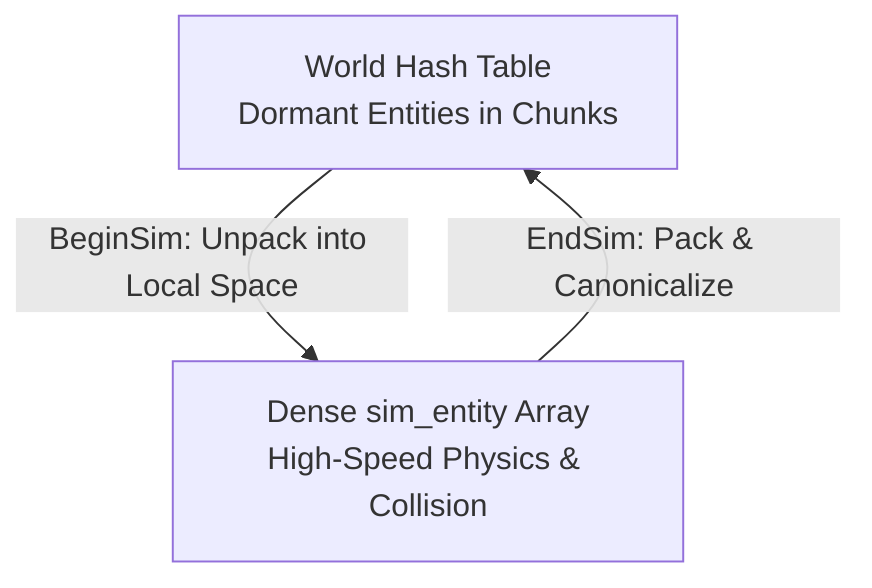

---

### Subsystem 5.6: Audio Mixing Engine
`handmade_audio.h`, `handmade_audio.cpp`

Digital audio is nothing more than an array of 16-bit signed PCM samples output to the sound hardware at 48,000 Hz. If the game produces even one sample too few, the audio buffer underruns, producing an audible pop or stutter.

In `handmade_audio.cpp`, audio mixing is vectorized using SSE instructions:

```c
// 4-Sample Stereo Audio Mix Loop
__m128 MasterVolume0 = _mm_set1_ps(AudioState->MasterVolume.E[0]);
__m128 Volume0 = _mm_setr_ps(Volume.E[0] + 0.0f*dVolume.E[0],
                             Volume.E[0] + 1.0f*dVolume.E[0],
                             Volume.E[0] + 2.0f*dVolume.E[0],
                             Volume.E[0] + 3.0f*dVolume.E[0]);
__m128 dVolumeChunk0 = _mm_set1_ps(4.0f * dVolume.E[0]);

// Load 4 raw PCM samples from the loaded sound asset
__m128 SourceSamples = _mm_loadu_ps((float *)Source);

// Multiply samples by linear volume ramp and accumulate into output channel
__m128 MixedChannel0 = _mm_add_ps(RealChannel0, _mm_mul_ps(MasterVolume0, _mm_mul_ps(Volume0, SourceSamples)));
_mm_store_ps((float *)RealChannel0, MixedChannel0);
```
Notice the volume ramping (`dVolume.E[0]`). If volume changes discontinuously from 1.0 to 0.0 between frames, it creates an audible click. We linearly ramp volume across individual audio samples using SIMD vector increments.

---

### Subsystem 5.7: Asset Streaming & File Formats
`handmade_file_formats.h`, `handmade_asset.h`, `handmade_asset.cpp`

Handmade Hero uses a custom binary package format: the **Handmade Hero Asset (.HHA)** file.

#### The Binary File Header
```c
#pragma pack(push, 1)
#define HHA_MAGIC_VALUE HHA_CODE('h','h','a','f')
#define HHA_VERSION 2

struct hha_header
{
    u32 MagicValue; // Must equal 'hhaf'
    u32 Version;    // Version 2
    u32 TagCount;
    u32 AssetCount;

    u32 Reserved32[12];

    u64 Tags;        // File offset to hha_tag[TagCount]
    u64 Assets;      // File offset to hha_asset[AssetCount]
    u64 Annotations; // File offset to metadata annotations
    u64 Reserved64[5];
};
CTAssert(sizeof(hha_header) == (16*4 + 8*8));
#pragma pack(pop)
```
Notice the compile-time assertion `CTAssert(sizeof(hha_header) == 128)`. We ensure binary alignment down to the exact byte across 32-bit and 64-bit architectures.

#### Multi-Dimensional Tag-Based Matching
Assets are not looked up by string paths (e.g., `"hero_walk_facing_left_01.png"`). String lookups are slow and brittle. Instead, assets are tagged with multi-dimensional floating-point vectors (`asset_tag`):

```c
struct hha_tag
{
    enum32(asset_tag_id) ID; // e.g., Tag_FacingDirection, Tag_Dodge, Tag_Hero
    r32 Value;               // e.g., Radians for direction, integer index
};
```
When looking up an animation frame for an entity facing $0.75\pi$ radians while taking damage, the asset engine computes the distance vector across all matching tags and selects the asset with the minimum mathematical error norm:

$$\text{Error} = \sum_{i} w_i \left( \text{TagValue}_i - \text{TargetValue}_i \right)^2$$

Assets are streamed asynchronously from disk on background worker threads without stalling the main render thread.

---

### Debugging, Diagnostics & Profiling

Profiling must be built into the core of your engine from day one. In `code/handmade_debug_interface.h`, we implement a high-resolution, lock-free performance instrumentation system:

#### Lock-Free RDTSC Instrumentation
The x86 `__rdtsc` (Read Time-Stamp Counter) intrinsic queries the CPU's internal clock cycles directly with near-zero overhead:

```c
#define RecordDebugEvent(EventType, GUIDInit, NameInit) \
    u64 ArrayIndex_EventIndex = AtomicAddU64(&GlobalDebugTable->EventArrayIndex_EventIndex, GlobalDebugTable->RecordIncrement); \
    u32 EventIndex = ArrayIndex_EventIndex & 0xFFFFFFFF; \
    debug_event *Event = GlobalDebugTable->Events[ArrayIndex_EventIndex >> 32] + EventIndex; \
    Event->Clock = __rdtsc(); \
    Event->Type = (u8)EventType; \
    Event->ThreadID = (u16)GetThreadID(); \
    Event->GUID = GUIDInit; \
    Event->Name = NameInit

#define TIMED_BLOCK(Name) timed_block TimedBlock_##Number(DEBUG_NAME(Name), Name)

struct timed_block
{
    timed_block(char *GUID, char *Name) { RecordDebugEvent(DebugType_BeginBlock, GUID, Name); }
    ~timed_block()                      { RecordDebugEvent(DebugType_EndBlock, "END_BLOCK_", "END_BLOCK_"); }
};
```

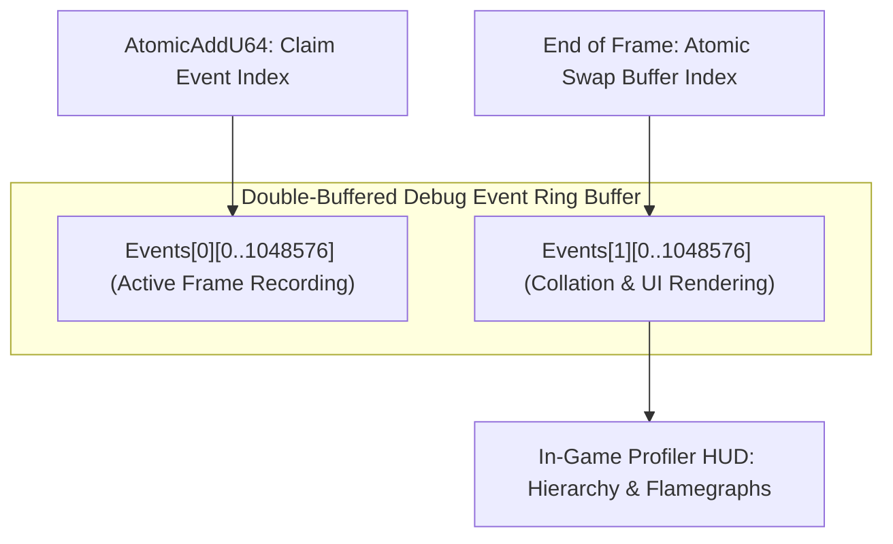

* **Zero Lock Contention**: Worker threads record timing markers concurrently using atomic additions (`AtomicAddU64`).
* **Frame Flamegraph Visualization**: The debug table double-buffers events. At frame boundaries, the engine collates events into a tree hierarchy displaying cycle counts, cache misses, and execution bottlenecks directly inside the game window!


---


# Module 6: The Execution Pipeline

Now that our subsystems are constructed, we must wire them into a cohesive, running machine. In this module, we walk through the entire execution lifecycle: from the OS entry point (`WinMain`), through memory initialization and the deterministic 60 FPS tick loop, down to the clean shutdown sequence.

### Architecture: The Complete Frame Pipeline

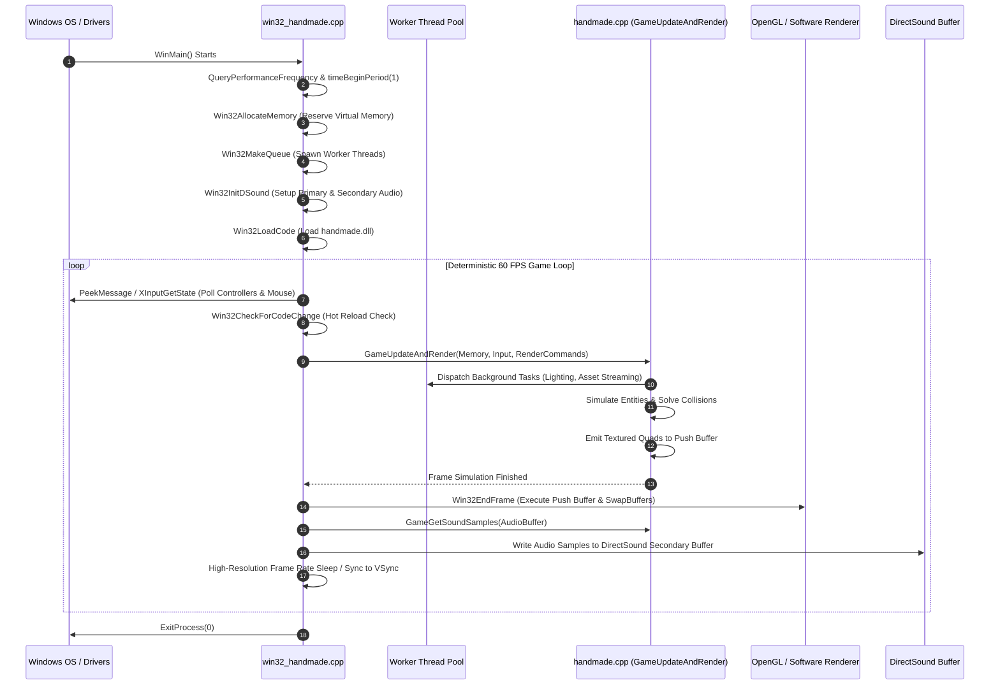

### Complete Implementation: The 60 FPS Main Loop

Let us trace the frame execution loop inside `code/win32_handmade.cpp`:

```c
int CALLBACK
WinMain(HINSTANCE Instance, HINSTANCE PrevInstance, LPSTR CommandLine, int ShowCode)
{
    // Step 1: Set Windows scheduler granularity to 1ms for accurate Sleep() timing
    UINT DesiredSchedulerMS = 1;
    b32 SleepIsGranular = (timeBeginPeriod(DesiredSchedulerMS) == TIMERR_NOERROR);
    
    // Step 2: Query high-resolution CPU performance counter frequency
    LARGE_INTEGER PerfCountFrequencyResult;
    QueryPerformanceFrequency(&PerfCountFrequencyResult);
    GlobalPerfCountFrequency = PerfCountFrequencyResult.QuadPart;
    
    // Step 3: Register custom window class and spawn main window
    WNDCLASSA WindowClass = {};
    WindowClass.style = CS_HREDRAW|CS_VREDRAW|CS_OWNDC;
    WindowClass.lpfnWndProc = Win32MainWindowCallback;
    WindowClass.hInstance = Instance;
    WindowClass.lpszClassName = "HandmadeHeroWindowClass";
    RegisterClassA(&WindowClass);
    
    HWND Window = CreateWindowExA(0, WindowClass.lpszClassName, "Handmade Hero",
                                  WS_OVERLAPPEDWINDOW|WS_VISIBLE,
                                  CW_USEDEFAULT, CW_USEDEFAULT,
                                  CW_USEDEFAULT, CW_USEDEFAULT,
                                  0, 0, Instance, 0);
    
    // Step 4: Allocate all engine memory in a single contiguous reservation
    game_memory GameMemory = {};
    GameMemory.PlatformAPI.AllocateMemory = Win32AllocateMemory;
    GameMemory.PlatformAPI.DeallocateMemory = Win32DeallocateMemory;
    
    // Step 5: Initialize multithreading work queues
    win32_thread_startup HighPriStartups[6];
    platform_work_queue HighPriorityQueue = {};
    Win32MakeQueue(&HighPriorityQueue, ArrayCount(HighPriStartups), HighPriStartups);
    GameMemory.HighPriorityQueue = &HighPriorityQueue;
    
    // Step 6: Initialize DirectSound audio buffer
    Win32InitDSound(Window, 48000, 48000*sizeof(s16)*2);
    
    // Step 7: Load game logic dynamic library
    win32_loaded_code GameCode = {};
    GameCode.DLLFullPath = "handmade.dll";
    GameCode.LockFullPath = "lock.tmp";
    Win32LoadCode(&GlobalWin32State, &GameCode);
    
    // Target fixed update rate: 60 FPS (16.666 milliseconds per frame)
    r32 GameUpdateHz = 60.0f;
    r32 TargetSecondsPerFrame = 1.0f / GameUpdateHz;
    
    LARGE_INTEGER LastCounter = Win32GetClock();
    u64 LastCycleCount = __rdtsc();
    
    GlobalRunning = true;
    while(GlobalRunning)
    {
        // ----------------------------------------------------------------
        // 1. Check for Hot Code Reloading
        // ----------------------------------------------------------------
        if(Win32CheckForCodeChange(&GameCode))
        {
            Win32ReloadCode(&GlobalWin32State, &GameCode);
        }
        
        // ----------------------------------------------------------------
        // 2. Poll OS Messages & Hardware Input (Keyboard, Mouse, Gamepad)
        // ----------------------------------------------------------------
        game_input NewInput = {};
        NewInput.dtForFrame = TargetSecondsPerFrame;
        
        MSG Message;
        while(PeekMessage(&Message, 0, 0, PM_REMOVE))
        {
            if(Message.message == WM_QUIT)
            {
                GlobalRunning = false;
            }
            TranslateMessage(&Message);
            DispatchMessageA(&Message);
        }
        
        Win32ProcessXBoxControllers(&NewInput);
        
        // ----------------------------------------------------------------
        // 3. Update & Render Simulation
        // ----------------------------------------------------------------
        game_render_commands RenderCommands = Win32BeginFrame();
        
        if(GameCode.UpdateAndRender)
        {
            GameCode.UpdateAndRender(&GameMemory, &NewInput, &RenderCommands);
        }
        
        // ----------------------------------------------------------------
        // 4. Dispatch Render Commands to Display Hardware
        // ----------------------------------------------------------------
        Win32EndFrame(&RenderCommands);
        
        // ----------------------------------------------------------------
        // 5. Update Audio Playback Buffer
        // ----------------------------------------------------------------
        Win32SyncAudio(&GameMemory, &GameCode);
        
        // ----------------------------------------------------------------
        // 6. Frame Rate Synchronization: Lock to 60 FPS
        // ----------------------------------------------------------------
        LARGE_INTEGER WorkCounter = Win32GetClock();
        r32 WorkSecondsElapsed = Win32GetSecondsElapsed(LastCounter, WorkCounter);
        
        r32 SecondsElapsedForFrame = WorkSecondsElapsed;
        if(SecondsElapsedForFrame < TargetSecondsPerFrame)
        {
            if(SleepIsGranular)
            {
                DWORD SleepMS = (DWORD)(1000.0f * (TargetSecondsPerFrame - SecondsElapsedForFrame));
                if(SleepMS > 0)
                {
                    Sleep(SleepMS);
                }
            }
            
            // Spin-lock the final sub-millisecond fractions for frame-perfect VSync timing
            while(SecondsElapsedForFrame < TargetSecondsPerFrame)
            {
                SecondsElapsedForFrame = Win32GetSecondsElapsed(LastCounter, Win32GetClock());
            }
        }
        
        // Performance diagnostics tracking
        LARGE_INTEGER EndCounter = Win32GetClock();
        u64 EndCycleCount = __rdtsc();
        
        s64 CyclesElapsed = EndCycleCount - LastCycleCount;
        r32 MSPerFrame = 1000.0f * Win32GetSecondsElapsed(LastCounter, EndCounter);
        r32 FPS = (r32)GlobalPerfCountFrequency / (r32)(EndCounter.QuadPart - LastCounter.QuadPart);
        
        LastCounter = EndCounter;
        LastCycleCount = EndCycleCount;
    }
    
    // Step 8: Clean shutdown
    if(SleepIsGranular)
    {
        timeEndPeriod(DesiredSchedulerMS);
    }
    ExitProcess(0);
}
```

---

### Debugging, Diagnostics & Profiling

The execution pipeline represents the macro-level heartbeat of the engine. Here is how to diagnose and optimize frame execution bottlenecks:

#### Audio Lag & Underrun Diagnostics
Audio latency is one of the hardest bugs to track down. If you write audio samples too close to the play cursor, the audio hardware catches up and stutters. If you write too far ahead, player actions feel lagged.

In `Win32SyncAudio`:
```c
DWORD PlayCursor, WriteCursor;
GlobalSecondaryBuffer->GetCurrentPosition(&PlayCursor, &WriteCursor);

// Calculate exact hardware latency in bytes:
DWORD BytesBetweenCursors = (PlayCursor <= WriteCursor) ? 
    (WriteCursor - PlayCursor) : 
    (SoundBufferSize - (PlayCursor - WriteCursor));

// Target latency: exactly 1 frame of audio safety margin (48000 / 60 = 800 samples)
DWORD TargetSafetyMarginBytes = (48000 / 60) * sizeof(s16) * 2;
```
* **Visualizing the Cursor**: The debug HUD draws a real-time circular graph of `PlayCursor` vs `WriteCursor`. If `WriteCursor` ever crosses the `PlayCursor`, an alert flashes red to signify an audio underrun!

#### Frame Timing & Latency Accounting
Under Windows, `QueryPerformanceCounter` measures wall-clock time with sub-microsecond precision.
* **Diagnosing Frame Drops**: If `MSPerFrame` exceeds $16.666\text{ ms}$, look at the `TopClocksList` view in the debug overlay. It ranks every function by total CPU cycles consumed:
  ```text
  Top Clocks (Last Frame):
  -------------------------------------------------------------
  Function                         Cycles           Hits
  -------------------------------------------------------------
  DrawRectangleSlowly              14,290,120       184
  SimulateEntities                  3,410,800         1
  OutputPlayingSounds               1,120,440         1
  -------------------------------------------------------------
  ```
* **Instant Optimization**: The diagnostics immediately reveal that 70% of the frame is spent inside `DrawRectangleSlowly`. You vectorize that routine using SSE intrinsics (as demonstrated in Module 5), run `build.bat`, and watch the cycle count drop from $14,000,000$ to $800,000$ cycles right before your eyes—without ever stopping the game!

---

### Conclusion & Master Summary

You have built a complete, production-grade game architecture from first principles. By replacing the bloated, indirect abstractions of modern software with:
* Direct, custom compilation scripts (`build.bat`)
* Linear memory arenas and hardware page guards (`handmade_memory.h`)
* Vectorized SIMD mathematics and coordinate chunking (`handmade_math.h`, `handmade_simd.h`)
* Lock-free atomic work queues (`win32_handmade.cpp`)
* Push buffer rendering with software SIMD rasterization and modern OpenGL
* Tag-based asset matching and multi-threaded background streaming
* Cycle-accurate, zero-overhead RDTSC diagnostics and dynamic hot reloading

...you have reclaimed the full computational power of modern computer hardware. You are no longer just a consumer of frameworks—you are a master systems architect.


---


# Module 7: Profiler Micro-Architecture, Instrumentation & Collation Engine

Performance is not an abstract virtue; it is the physical measurement of how efficiently your code utilizes CPU transistors, execution ports, cache hierarchies, and memory buses. Most programmers rely on external sampling profilers or coarse OS millisecond timers (`GetTickCount`, `std::chrono`). But when you are optimizing an inner loop that runs in 20 nanoseconds, millisecond timers are completely blind, and statistical sampling profilers cannot reconstruct the deterministic, cycle-accurate sequence of events that caused an isolated frame drop.

In this module, we conduct an exhaustive, micro-architectural deep dive into the **Handmade Hero In-Engine Profiler** (`code/handmade_debug_interface.h`, `code/handmade_debug.h`, `code/handmade_debug.cpp`). We will learn how the CPU hardware timestamp counter works under out-of-order execution, how lock-free atomic circular buffers eliminate thread contention, how the collation engine turns flat timestamp streams into hierarchical execution call-trees, how bidirectional data binding (`DEBUG_VALUE`) enables live hot-variable tuning, and how to visualize thread execution intervals.

---

### Hardware Fundamentals: The Timestamp Counter (`RDTSC`)

The core instrument of our profiling engine is the x86 `__rdtsc()` (Read Time-Stamp Counter) intrinsic. Every modern x86/x64 processor features a 64-bit Model-Specific Register (MSR) that counts clock cycles.

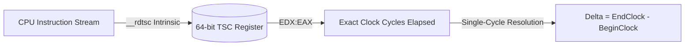

#### Invariant TSC vs. Variable Clock Frequencies
In older processors (prior to Nehalem / K10), the TSC incremented with the processor's current core frequency. If the CPU entered a power-saving state (SpeedStep / TurboBoost), the clock frequency dropped, distorting your measurements.

Modern processors provide **Constant and Invariant TSC**:
1. **Constant**: The TSC runs at a constant rate regardless of CPU P-state or thermal throttling.
2. **Invariant**: The counter runs continuously across all power states, including deep ACPI sleep states ($C3/C4$).

#### Out-of-Order Execution & Instruction Reordering Hazards
Modern superscalar CPUs execute instructions **out of order** (OOO). An x86 processor can reorder speculative arithmetic operations, loads, and stores around an `rdtsc` instruction if there are no register dependencies!

Consider this naive benchmark:
```c
u64 Start = __rdtsc();
DoComplexWork(); // <-- CPU may speculatively execute this BEFORE the Start timestamp is read!
u64 End = __rdtsc();
```

To prevent the out-of-order execution pipeline from hoisting instructions across the measurement boundary, we enforce hardware serialization:

```c
// Full pipeline serialization boundary
#if COMPILER_MSVC
    // _mm_lfence() serializes instruction retirement on modern x86 processors:
    // It prevents previous loads/stores from retiring after the fence,
    // and prevents subsequent instructions from executing before the fence!
    _mm_lfence();
    u64 Start = __rdtsc();
    _mm_lfence();
#endif
```

#### Why Cycles Per Unit Beats Milliseconds
Millisecond measurements fluctuate depending on background OS tasks, thread context switches, and CPU frequency scaling. **Clock cycles are the fundamental unit of work on a microprocessor**.

When optimizing code, we measure in **Cycles per Element**:
* **Software Rasterizer**: Measured in **Cycles per Pixel**. If blending a pixel takes $40\text{ cycles}$ and your target is $1920 \times 1080$ at $60\text{ FPS}$ ($124{,}416{,}000\text{ pixels/sec}$), a $3.0\text{ GHz}$ CPU provides:
  $$\frac{3{,}000{,}000{,}000 \text{ cycles/sec}}{124{,}416{,}000 \text{ pixels/sec}} \approx 24.1 \text{ cycles per pixel budget}$$
  If your rasterizer inner loop burns $40\text{ cycles/pixel}$, you know with mathematical certainty that software rendering will drop below 60 FPS!
* **Audio Mixer**: Measured in **Cycles per Sample**.
* **Asset Decompressor**: Measured in **Cycles per Byte**.

---

### The Lock-Free Double-Buffered Ring Buffer

When multiple threads execute `TIMED_BLOCK("Physics")` or `TIMED_FUNCTION()`, they must record timing events concurrently. If threads write to a shared linked list protected by an OS mutex, the profiler itself will bottleneck the engine, burning tens of thousands of cycles in kernel transitions and invalidating measurements.

In `code/handmade_debug_interface.h`, the recording engine uses a **Lock-Free Double-Buffered Ring Buffer**:

$$\text{Events}[2][16 \times 65536] \quad (\approx 1{,}048{,}576 \text{ events per buffer})$$

```c
struct debug_table
{
    debug_event EditEvent;
    v2 MouseP;
    u32 RecordIncrement; // 1 when recording, 0 when paused
    
    u32 CurrentEventArrayIndex; // 0 or 1
    
    // 64-bit atomic counter packed with Array Index and Event Index
    u64 volatile EventArrayIndex_EventIndex;
    
    // Double-buffered circular event array (1,048,576 events per buffer!)
    debug_event Events[2][16 * 65536];
};
```

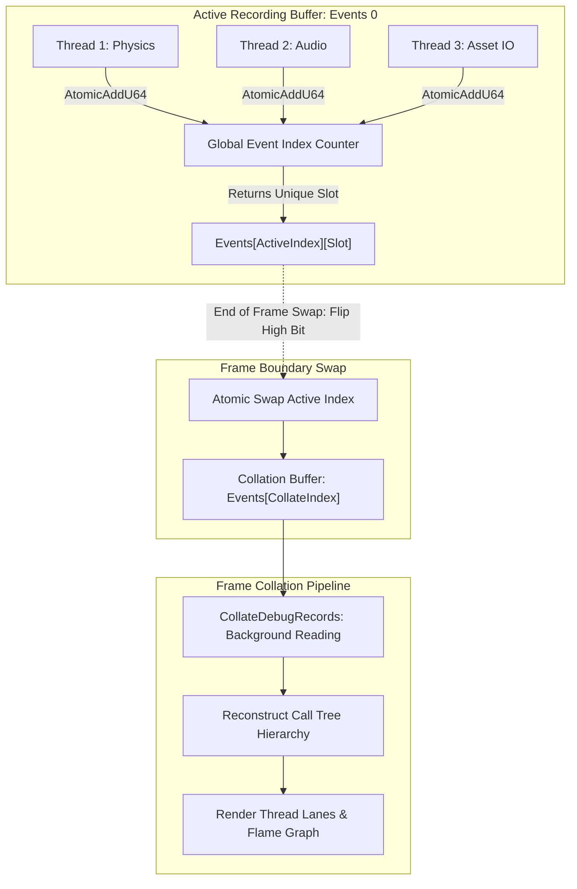

#### Atomic Index Reservation (`RecordDebugEvent`)
Look at how `RecordDebugEvent` is defined in `code/handmade_debug_interface.h`:

```c
#define RecordDebugEvent(EventType, GUIDInit, NameInit) \
    /* Step 1: Atomically claim a unique slot in the circular ring buffer */ \
    u64 ArrayIndex_EventIndex = AtomicAddU64(&GlobalDebugTable->EventArrayIndex_EventIndex, \
                                             GlobalDebugTable->RecordIncrement); \
    \
    /* The lower 32 bits represent the slot index within the active array */ \
    u32 EventIndex = ArrayIndex_EventIndex & 0xFFFFFFFF; \
    Assert(EventIndex < ArrayCount(GlobalDebugTable->Events[0])); \
    \
    /* The upper 32 bits select Buffer 0 or Buffer 1 */ \
    debug_event *Event = GlobalDebugTable->Events[ArrayIndex_EventIndex >> 32] + EventIndex; \
    \
    /* Step 3: Sample the CPU hardware cycle counter directly */ \
    Event->Clock = __rdtsc(); \
    Event->Type = (u8)EventType; \
    Event->CoreIndex = 0; \
    Event->ThreadID = (u16)GetThreadID(); \
    Event->GUID = GUIDInit; \
    Event->Name = NameInit
```

#### Why This Design Is Zero-Contention:
1. `AtomicAddU64` on x64 compiles directly to the `LOCK XADD` instruction. The CPU hardware cache-coherency bus handles the atomic increment in $\approx 10\text{ to }15\text{ ns}$.
2. `__rdtsc` compiles to a single `rdtsc` machine opcode, reading the 64-bit cycle count register directly into `EDX:EAX` without an OS system call.
3. Every thread receives an independent, non-overlapping struct pointer (`Event`). There is **zero memory stomping** and **zero false sharing** across cache lines.
4. No thread ever waits for another thread to finish writing its event.

---

### Frame Collation: Call-Tree Reconstruction

Raw debug events are written into memory as a flat temporal stream:
```text
Event 0: Thread 1 | BeginBlock | "GameUpdateAndRender" | Clock: 1000
Event 1: Thread 2 | BeginBlock | "AudioMix"            | Clock: 1020
Event 2: Thread 1 | BeginBlock | "SimulateEntities"    | Clock: 1050
Event 3: Thread 1 | EndBlock   | "SimulateEntities"    | Clock: 1400
Event 4: Thread 2 | EndBlock   | "AudioMix"            | Clock: 1450
Event 5: Thread 1 | EndBlock   | "GameUpdateAndRender" | Clock: 2100
```

Notice that events from different threads are interleaved chronologically! At frame boundaries, `CollateDebugRecords` (`code/handmade_debug.cpp`) unrolls this flat stream and reconstructs a structured call-tree:

```mermaid
flowchart TD
    ROOT["RootProfileNode (Total Frame Time: 1100 cycles)"]
    ROOT --> GU["GameUpdateAndRender (Thread 1: 1100 cycles)"]
    ROOT --> AM["AudioMix (Thread 2: 430 cycles)"]
    GU --> SIM["SimulateEntities (Thread 1: 350 cycles)"]
    
    subgraph Cycle Breakdown Calculation
        direction TB
        E1["Total Duration (Inclusive): EndClock - BeginClock"]
        E2["DurationOfChildren: Sum of all direct child block durations"]
        E3["Self Time (Exclusive): Total Duration - DurationOfChildren"]
    end
```

#### The Stack Tracking Structure: `open_debug_block`
To match `BeginBlock` with its corresponding `EndBlock` across arbitrary call depths and recursion, each thread maintains an explicit stack of open blocks:

```c
struct open_debug_block
{
    union
    {
        open_debug_block *Parent;   // Pointer to enclosing parent scope
        open_debug_block *NextFree; // Free-list pointer for zero-allocation pooling
    };
    
    u32 StartingFrameIndex;
    debug_element *Element;
    u64 BeginClock;
    debug_stored_event *Node;
};
```

#### The Hierarchical Collation Algorithm: `CollateDebugRecords`
At the end of each frame, `CollateDebugRecords` in `code/handmade_debug.cpp` converts this flat stream into a nested parent-child call tree (`debug_profile_node`):

```c
case DebugType_BeginBlock:
{
    ++CollationFrame->ProfileBlockCount;
    debug_element *Element = GetElementFromEvent(DebugState, Event, DebugState->ProfileGroup,
                                                 DebugElement_AddToGroup);
    
    // Find who the active parent node is for THIS thread
    debug_stored_event *ParentEvent = CollationFrame->RootProfileNode;
    u64 ClockBasis = CollationFrame->BeginClock;
    if(Thread->FirstOpenCodeBlock)
    {
        ParentEvent = Thread->FirstOpenCodeBlock->Node;
        ClockBasis = Thread->FirstOpenCodeBlock->BeginClock;
    }
    
    // Allocate a new stored profile node
    debug_stored_event *StoredEvent = StoreEvent(DebugState, Element, Event);
    debug_profile_node *Node = &StoredEvent->ProfileNode;
    Node->Element = Element;
    Node->FirstChild = 0;
    Node->ParentRelativeClock = Event->Clock - ClockBasis;
    Node->Duration = 0;
    Node->DurationOfChildren = 0;
    Node->ThreadOrdinal = (u16)Thread->LaneIndex;
    Node->CoreIndex = Event->CoreIndex;
    
    // Link as child of current parent
    Node->NextSameParent = ParentEvent->ProfileNode.FirstChild;
    ParentEvent->ProfileNode.FirstChild = StoredEvent;
    
    // Push onto this thread's open block stack
    open_debug_block *DebugBlock = AllocateOpenDebugBlock(
        DebugState, Element, FrameIndex, Event, &Thread->FirstOpenCodeBlock);
    DebugBlock->Node = StoredEvent;
} break;

case DebugType_EndBlock:
{
    if(Thread->FirstOpenCodeBlock)
    {
        open_debug_block *MatchingBlock = Thread->FirstOpenCodeBlock;
        Assert(Thread->ID == Event->ThreadID);
        
        // Total Duration = EndClock - BeginClock
        debug_profile_node *Node = &MatchingBlock->Node->ProfileNode;
        Node->Duration = Event->Clock - MatchingBlock->BeginClock;
        
        // Pop off thread stack
        DeallocateOpenDebugBlock(DebugState, &Thread->FirstOpenCodeBlock);
        
        // Accumulate child duration into parent node
        if(Thread->FirstOpenCodeBlock)
        {
            debug_profile_node *ParentNode = &Thread->FirstOpenCodeBlock->Node->ProfileNode;
            ParentNode->DurationOfChildren += Node->Duration;
        }
    }
} break;
```

```mermaid
graph TD
    ROOT["RootProfileNode (Total Frame Time)"] --> SIM["SimulateEntities (Duration = 3,400,000 cycles)"]
    ROOT --> RAST["DrawRectangleSlowly (Duration = 14,000,000 cycles)"]
    ROOT --> AUD["OutputPlayingSounds (Duration = 1,100,000 cycles)"]
    
    SIM --> COL["SolveCollision (DurationOfChildren = 1,800,000 cycles)"]
    SIM --> BRAIN["ExecuteBrainLogic (DurationOfChildren = 900,000 cycles)"]
    
    subgraph Self Time vs Child Time Calculation
        CALC["Self Cycles = Node->Duration - Node->DurationOfChildren"]
    end
```

By computing $\text{Self Time} = \text{Duration} - \text{DurationOfChildren}$, the engine instantly identifies which specific function is burning cycles vs. which function is simply waiting on child calls:

$$\text{Exclusive Cycles} = \text{Node->Duration} - \text{Node->DurationOfChildren}$$

---

### Profiler Visualization: Thread Intervals & Top Clocks

Once collated, the debug system renders interactive diagnostic views directly to the screen via the immediate-mode UI:

#### 1. The Thread Interval Graph (`DebugType_ThreadIntervalGraph`)
Each hardware thread is assigned a horizontal lane on screen. The horizontal axis represents normalized frame time:

$$X = \text{LaneStart} + \text{LaneWidth} \times \left( \frac{\text{EventClock} - \text{FrameBeginClock}}{\text{FrameTotalCycles}} \right)$$

```text
Thread 0 (Main):  [==== GameUpdateAndRender ====] [=== RenderCommands ===] [ Wait ]
Thread 1 (Worker):        [=== Lighting Tile 0 ===]       [=== Lighting Tile 2 ===]
Thread 2 (Worker):        [=== Lighting Tile 1 ===]       [=== Lighting Tile 3 ===]
Thread 3 (Audio):  [ AudioMix ]
```

* **Instant Bubble Detection**: If you see large empty gaps on worker threads, your job chunk sizes are too large or uneven, causing **pipeline starvation**.
* **Lock Contention Spikes**: If a thread shows a massive block named `BeginTicketMutex`, you immediately see that worker threads are stalling each other on a shared resource!

#### 2. The Top Clocks Table (`DebugType_TopClocksList`)
Aggregates all execution records across the frame and sorts them by **Total Exclusive Cycles**:

```text
--------------------------------------------------------------------------------
Function Name                    Calls      Total Cycles    Avg/Call   % Frame
--------------------------------------------------------------------------------
DrawRectangleSlowly                184        14,290,120      77,663     71.2%
SimulateEntities                     1         3,410,800   3,410,800     17.0%
OutputPlayingSounds                  1         1,120,440   1,120,440      5.6%
SolveCollision                    2410           850,200         352      4.2%
--------------------------------------------------------------------------------
```

---

### In-Place Hot Variable Editing: `DEBUG_VALUE`

The debug system is not just read-only. It provides seamless **bidirectional data binding**.

```c
#define DEBUG_VALUE(Value)  \
{ \
    RecordDebugEvent(DebugType_Unknown, DEBUG_NAME(#Value), #Value); \
    DEBUGValueSetEventData(Event, Value, (void *)&(Value)); \
}
```

Look closely at `DEBUGValueSetEventData`:
```c
inline void
DEBUGValueSetEventData(debug_event *Event, r32 Ignored, void *Value)
{
    Event->Type = DebugType_r32;
    // Check if the developer edited this variable in the in-game UI!
    if(GlobalDebugTable->EditEvent.GUID == Event->GUID)
    {
        *(r32 *)Value = GlobalDebugTable->EditEvent.Value_r32;
    }
    Event->Value_r32 = *(r32 *)Value;
}
```

When you drag a variable slider in the in-game developer UI:
1. The UI sets `GlobalDebugTable->EditEvent` with the matching GUID and the newly edited value.
2. On the very next game tick, when simulation code executes `DEBUG_VALUE(PlayerSpeed)`, it detects the GUID match and **overwrites the local variable directly in place**!
3. You get full live-tuning capability with zero reflection, zero type metadata registries, and zero memory allocations.

---

### Integrating Intel Architecture Code Analyzer (IACA)

Notice in `code/build.bat` that Casey links `-I..\iaca-win64\` and uses `#include <iacaMarks.h>` in `code/handmade_renderer_software.cpp`.

**IACA** is an advanced static analysis tool by Intel that simulates how x86 assembly instructions flow through the processor's execution ports, reservation stations, and reorder buffers.

To analyze an inner loop with IACA:
```c
#include <iacaMarks.h>

for(int Pixel = 0; Pixel < Count; ++Pixel)
{
    // Insert special opcode markers that IACA intercepts during analysis:
    IACA_VC64_START;

    // Inner loop SIMD math
    __m128 Dest = _mm_load_ps(Pixels + Pixel);
    Dest = _mm_add_ps(Dest, Source);
    _mm_store_ps(Pixels + Pixel, Dest);

    IACA_VC64_END;
}
```
IACA analyzes the compiled machine opcodes between `START` and `END` and outputs a breakdown of:
* Throughput bottleneck (Port 0, Port 1, Port 5, memory load/store ports).
* Theoretical maximum IPC (Instructions Per Cycle).
* Register dependencies and pipeline stalls.

---

### Debugging, Diagnostics & Overhead Measurement

#### Profiling the Profiler Overhead
How much time does our profiling infrastructure actually take?
* **Measuring Instrumentation Cost**: Run 1,000,000 back-to-back iterations of `TIMED_BLOCK("Test")`:
  ```c
  u64 Start = __rdtsc();
  for(int i = 0; i < 1000; ++i) {
      TIMED_BLOCK("Bench");
  }
  u64 Elapsed = __rdtsc() - Start;
  // Elapsed / 1000 reveals exact clock cycles per timed scope!
  ```
  On a modern x86 CPU, a complete `timed_block` entry and exit consumes approximately **24 clock cycles** ($\approx 5\text{ nanoseconds}$).
* **Buffer Overflow Prevention**: If `EventIndex` approaches `16 * 65536`, `RecordDebugEvent` triggers an assertion. If you are logging millions of events per frame, scale up the event buffer size in `handmade_debug_interface.h` or filter high-frequency tight loops by removing `TIMED_FUNCTION()` from per-pixel/per-vertex inner loops.

#### Detecting Frame Slips in the Profiler
When the engine runs at 60 FPS, every frame must finish within $\frac{1}{60\text{ Hz}} \approx 16.666\text{ ms}$.
* In `code/handmade_debug.cpp`, look at `CollationFrame->WallSecondsElapsed`.
* If `WallSecondsElapsed > 0.0167f`, `DrawFrameBars()` renders that frame's vertical bar in **bright red**:
  ```c
  if(Frame->WallSecondsElapsed > TargetSecondsPerFrame)
  {
      BarColor = V4(1.0f, 0.2f, 0.2f, 1.0f); // RED: Frame dropped!
  }
  else
  {
      BarColor = V4(0.2f, 1.0f, 0.2f, 1.0f); // GREEN: Frame within budget
  }
  ```
* Clicking on any past red bar in the in-game Frame Slider freezes the debug state on that exact dropped frame, allowing you to inspect the call-tree and find the spike!


---


# Module 8: The Immediate-Mode Developer UI (IMGUI) Subsystem

Most graphical user interfaces (Qt, WinForms, WPF, DOM) use **Retained-Mode UI**: you allocate widget objects (`Button`, `TreeItem`, `Layout`), register event callbacks, synchronize state between the widget and your game variables, and worry about lifetime management. This creates massive memory overhead, pointer indirection, and synchronization bugs where the UI displays stale data.

In `handmade_dev_ui.h` and `handmade_dev_ui.cpp`, we build an **Immediate-Mode GUI (IMGUI)**. The UI holds no persistent widget instances. Every frame, you declare what should appear on screen, the UI system checks mouse collision, handles interaction, and draws the geometry directly into the render push buffer.

### Architecture: The Three-State Interaction Lifecycle

To handle clicks, drags, resizes, and hot-hover states without persistent widget objects, we track three variables across frame boundaries:

$$\text{Interaction} \quad (\text{Active widget currently grabbed by the user})$$
$$\text{HotInteraction} \quad (\text{Widget under the mouse on the current frame})$$
$$\text{NextHotInteraction} \quad (\text{Candidate widget under the mouse for next frame})$$

```mermaid
stateDiagram-v2
    [*] --> Idle: Mouse not over widget
    Idle --> Hot: Mouse hovers over widget (NextHotInteraction)
    Hot --> Active: Mouse Button Down (Becomes UI->Interaction)
    Active --> Active: Mouse Dragged (Adjusts live variable)
    Active --> Hot: Mouse Button Released
    Hot --> Idle: Mouse leaves bounding box
```

Every interactive element is identified by a unique, collision-resistant 128-bit identifier (`dev_id`).

### Core Data Structures: `handmade_dev_ui.h`

Let us inspect the foundational structures governing the developer UI from `code/handmade_dev_ui.h`:

```c
#if !defined(HANDMADE_DEV_UI_H)
/* ========================================================================
   $File: handmade_dev_ui.h $
   $Creator: Casey Muratori $
   ======================================================================== */

#define HANDMADE_DEV_UI_H

// 128-bit unique identifier for any interactive widget
struct dev_id
{
    union
    {
        void *Void;
        u64 U64;
        u32 U32[2];
    } Value[2];
};

enum dev_ui_interaction_type
{
    DevUI_Interaction_None,
    DevUI_Interaction_NOP,
    
    // Value manipulation
    DevUI_Interaction_ToggleValue,
    DevUI_Interaction_DragValue,
    DevUI_Interaction_Draggable,
    
    // Window & layout manipulation
    DevUI_Interaction_Resize,
    DevUI_Interaction_Move,
    
    // Tree navigation
    DevUI_Interaction_ToggleExpansion,
    
    // Immediate buttons
    DevUI_Interaction_ImmediateButton,
};

struct dev_ui_interaction
{
    dev_id ID;
    dev_ui_interaction_type Type;
    
    void *Target;
    union
    {
        void *Generic;
        void *Pointer;
        u32 UInt32;
        v2 *P;
        struct debug_element *Element;
    };
};

struct dev_ui
{
    font_id FontID;
    struct hha_font *FontInfo;
    f32 FontScale;
    
    // Z-layering transforms
    v3 ToolTipTransform;
    v3 TextTransform;
    v3 ShadowTransform;
    v3 UITransform;
    v3 BackingTransform;
    
    rectangle2 UISpace;
    
    // Mouse coordinates in virtual UI space
    v2 MouseP;
    v2 dMouseP; // Delta mouse movement since last frame
    v2 LastMouseP;
    b32 AltUI;  // High-density / alternate view toggle
    
    // The three core interaction tokens
    dev_ui_interaction Interaction;         // Currently ACTIVE widget (mouse down)
    dev_ui_interaction HotInteraction;      // Currently HOT widget (hovered)
    dev_ui_interaction NextHotInteraction;  // HOT candidate for next frame
    
    struct dev_ui_line_buffer ToolTips;
    render_group RenderGroup;
    struct loaded_font *Font;
    rectangle2 DefaultClipRect;
};

// Hierarchical layout cursor for automatic formatting
struct dev_ui_layout
{
    dev_ui *UI;
    v2 MouseP;
    v2 BaseCorner;
    
    u32 Depth; // Indentation depth for nested trees
    v2 At;     // Current top-left insertion cursor
    
    f32 LineAdvance;
    f32 NextYDelta;
    f32 SpacingX;
    f32 SpacingY;
    f32 Thickness;
    
    u32 NoLineFeed; // When > 0, elements stack horizontally in a row
    b32 LineInitialized;
    b32 EditOccurred;
};
```

### Layout Math & Element Placement

In `handmade_dev_ui.cpp`, layout is handled procedurally. Rather than calculating complex CSS-style constraint graphs, the layout maintains a running cursor (`Layout->At`):

$$\text{Element}_{\text{Min}} = \left( \text{At}_x, \, \text{At}_y - \text{Height} \right)$$
$$\text{Element}_{\text{Max}} = \left( \text{At}_x + \text{Width}, \, \text{At}_y \right)$$

When an element finishes (`EndElement`), the cursor advances downward by the element's height plus `SpacingY`. If `BeginRow()` was called, `NoLineFeed` is incremented, and elements advance horizontally across the X axis.

```c
inline void
EndElement(dev_ui_layout_element *Element)
{
    dev_ui_layout *Layout = Element->Layout;
    dev_ui *UI = Layout->UI;
    
    // Apply indentation based on tree depth
    if(!Layout->LineInitialized)
    {
        Layout->At.x = Layout->BaseCorner.x + Layout->Depth * 2.0f * Layout->LineAdvance;
        Layout->LineInitialized = true;
        Layout->NextYDelta = 0.0f;
    }
    
    v2 TotalDim = *Element->Dim;
    v2 TotalMinCorner = V2(Layout->At.x, Layout->At.y - TotalDim.y);
    v2 TotalMaxCorner = TotalMinCorner + TotalDim;
    
    Element->Bounds = RectMinMax(TotalMinCorner, TotalMaxCorner);
    
    // Check if the mouse is hovering over this element:
    // If so, mark it as NextHotInteraction for the upcoming frame!
    if(Element->Interaction.Type && IsInRectangle(Element->Bounds, Layout->MouseP))
    {
        UI->NextHotInteraction = Element->Interaction;
    }
    
    // Advance cursor forward or down
    AdvanceElement(Layout, Element->Bounds);
}
```

### Implementing Draggable Live Variables: `EditablePx`

To see the power of immediate-mode development UI, look at `EditablePx`. This function renders a floating-point number as text. If the user clicks and drags horizontally, it modifies the live floating-point variable directly in memory:

```c
internal void
EditablePx(dev_ui_layout *Layout, dev_id ID, string LabelText,
           f32 MinX, f32 *X, f32 MaxX, f32 dX = 0)
{
    dev_ui *UI = Layout->UI;
    
    // Format text: "VariableName(12.34)"
    char Temp[64];
    string TempString;
    TempString.Count = FormatString(sizeof(Temp), Temp, "%S(%.02f)", LabelText, *X);
    TempString.Data = (u8 *)Temp;
    
    dev_ui_interaction Interaction = {};
    Interaction.ID = ID;
    Interaction.Type = DevUI_Interaction_Draggable;
    
    // Draw the text button
    BasicTextElement(Layout, TempString, Interaction,
                     V4(0.8f, 0.8f, 0.8f, 1),
                     V4(1, 1, 1, 1), Layout->Thickness,
                     V4(0.7f, 0.5f, 0.3f, 0.5f));
    
    // If THIS specific widget is currently active (being dragged):
    if(InteractionsAreEqual(Interaction, UI->Interaction))
    {
        if(!dX)
        {
            dX = 0.001f * (MaxX - MinX);
        }
        
        // Adjust the live variable by mouse delta movement!
        *X = Clamp(MinX, *X + dX * UI->dMouseP.x, MaxX);
        Layout->EditOccurred = true;
    }
}
```
Think about what this means: with one line of code, any game variable (camera zoom, gravity, light bounce intensity) becomes a live, draggable slider on screen. No event handlers, no binding objects.

---

### Debugging, Diagnostics & Profiling

#### Inspecting the IMGUI Interaction Graph
When developing immediate-mode interfaces, the most common bug is **interaction hijacking** (an invisible parent container stealing mouse hover events from child buttons).
* **Diagnosing Stolen Focus**: In `code/handmade_dev_ui.cpp`, insert a debug print inside `EndElement`:
  ```c
  if(Element->Interaction.Type && IsInRectangle(Element->Bounds, Layout->MouseP))
  {
      OutputDebugStringA(Element->Interaction.Type == DevUI_Interaction_NOP ? 
                         "Background Blocked Input!\n" : "Valid Hover\n");
  }
  ```
* **Visualizing UI Bounds**: In `EndElement()`, temporarily uncomment the border push rectangle. This draws bright wireframe outlines around every UI bounding box, revealing alignment padding, negative spacing, and clipping rectangles in real time.


---


# Module 9: Deep-Dive Memory Tracking, Auditing & Hardware Verification

Memory leaks and heap corruptions are the bane of low-level systems. In traditional C/C++, developers use Valgrind, AddressSanitizer (ASan), or custom malloc hooks. But these tools slow execution down by $2\times$ to $10\times$ and do not understand domain-specific memory lifetimes.

In Handmade Hero, because **all memory is allocated through arenas**, we turn the debug system into a real-time memory auditor (`debug_arena`). We track block allocations, watermarks, scratch truncations, and individual allocation call sites without dropping below 60 FPS.

### Architecture: Real-Time Memory Telemetry

Every time a memory arena operation occurs in `handmade_memory.h`, it emits an event into our lock-free debug stream:

```mermaid
sequenceDiagram
    autonumber
    participant Code as Engine Subsystem
    participant Arena as memory_arena
    participant Debug as Global Debug Table
    participant Collate as CollateDebugRecords
    participant UI as Memory Graph Visualizer

    Code->>Arena: PushStruct(WorldArena, entity)
    Arena->>Debug: DEBUG_RECORD_ALLOCATION(Block, GUID, Size, Offset)
    Code->>Arena: BeginTemporaryMemory(ScratchArena)
    Code->>Arena: PushArray(ScratchArena, 1024, v3)
    Arena->>Debug: DEBUG_RECORD_ALLOCATION(...)
    Code->>Arena: EndTemporaryMemory(ScratchArena)
    Arena->>Debug: DEBUG_RECORD_BLOCK_TRUNCATE(Block, PreviousUsed)
    Note over Debug,Collate: Frame Swap & Collation
    Collate->>UI: Reconstruct Active Allocations vs Free Space
    UI-->>Code: Real-Time Interactive Arena Memory Bar Rendered on Screen!
```

### The Memory Recording Macros

Let us examine the telemetry hooks embedded directly inside `code/handmade_debug_interface.h` and `code/handmade_memory.h`:

```c
// Track arena naming
#define DEBUG_ARENA_NAME(Ar, Name) \
{ \
    RecordDebugEvent(DebugType_ArenaSetName, DEBUG_NAME("ArenaSetName"), Name); \
    Event->Value_debug_memory_op.Block = (Ar)->CurrentBlock; \
    Event->Value_debug_memory_op.AllocatedSize = 0; \
}

// Track temporary memory rollback / truncation
#define DEBUG_RECORD_BLOCK_TRUNCATE(Bl) \
{ \
    RecordDebugEvent(DebugType_ArenaBlockTruncate, DEBUG_NAME("ArenaBlockTruncate"), "Truncation"); \
    Event->Value_debug_memory_op.Block = (Bl); \
    Event->Value_debug_memory_op.AllocatedSize = (Bl)->Used; \
}

// Track new OS page allocations (Platform.AllocateMemory)
#define DEBUG_RECORD_BLOCK_ALLOCATION(Bl) \
{ \
    RecordDebugEvent(DebugType_ArenaBlockAllocate, DEBUG_NAME("ArenaBlockAllocate"), "BlockAlloc"); \
    Event->Value_debug_memory_block_op.ArenaLookupBlock = (Bl)->ArenaPrev; \
    Event->Value_debug_memory_block_op.Block = (Bl); \
    Event->Value_debug_memory_block_op.AllocatedSize = (Bl)->Size; \
}

// Track individual allocations inside an arena block
#define DEBUG_RECORD_ALLOCATION(Bl, GUIDInit, SizeAlloc, SizeInit, Offset) \
{ \
    RecordDebugEvent(DebugType_ArenaAllocate, GUIDInit, "ArenaAlloc"); \
    Event->Value_debug_memory_op.Block = (Bl); \
    Event->Value_debug_memory_op.AllocatedSize = (SizeAlloc); \
    Event->Value_debug_memory_op.OffsetInBlock = (Offset); \
}
```

### Collation & In-Game Memory Graph Construction

In `code/handmade_debug.cpp`, when `CollateDebugRecords` encounters `DebugType_ArenaBlockTruncate` or `DebugType_ArenaAllocate`, it updates a dedicated set of `debug_arena` tracking structures:

```c
struct debug_arena_allocation
{
    debug_arena_allocation *Next;
    umm OffsetFromBlock;
    umm SizeAllocated;
    u32 CallSiteIndex;
};

struct debug_arena_block
{
    debug_arena_block *Next;
    debug_arena_allocation *FirstAllocation;
    debug_arena_allocation *LastAllocation;
    umm MemoryAddress;
    umm SizeAllocated;
};

struct debug_arena
{
    debug_arena *Next;
    char *Name;
    debug_arena_block *FirstBlock;
    b32x Suppress;
    
    umm CurTotalAlloc;
    umm PeakTotalAlloc;
};
```

#### Reconstructing Truncations:
When temporary memory rolls back, `DEBUGArenaBlockTruncate` walks the allocation chain and prunes every allocation record that occurred past the new watermark:

```c
internal void
DEBUGArenaBlockTruncate(debug_state *DebugState, debug_event *Event)
{
    debug_arena_block *Block = GetArenaBlock(DebugState, Event->Value_debug_memory_op.Block);
    if(Block)
    {
        umm TruncateToOffset = Event->Value_debug_memory_op.AllocatedSize;
        debug_arena_allocation **AllocPtr = &Block->FirstAllocation;
        while(*AllocPtr)
        {
            debug_arena_allocation *Alloc = *AllocPtr;
            if(Alloc->OffsetFromBlock >= TruncateToOffset)
            {
                // Free this allocation record back to the debug pool
                *AllocPtr = Alloc->Next;
                FreeArenaAllocation(DebugState, Alloc);
            }
            else
            {
                AllocPtr = &Alloc->Next;
            }
        }
    }
}
```
This guarantees that the in-game memory viewer displays the **exact, physical state of memory** at any given microsecond.

### The Debug Suppression Idiom: Preventing Heisenbugs

Consider this fatal circular trap:
1. The memory arena performs an allocation.
2. The allocation emits a `DEBUG_RECORD_ALLOCATION` event.
3. The debug system collates the event and allocates a `debug_arena_allocation` node.
4. Step 3 calls the memory allocator, which emits another debug event!
5. **Infinite recursion $\rightarrow$ Stack Overflow!**

Handmade Hero solves this cleanly with **Arena Suppression** (`DEBUG_ARENA_SUPPRESS`):

```c
internal debug_state *
DEBUGInit(game_assets *Assets)
{
    debug_state *DebugState = BootstrapPushStruct(debug_state, DebugArena);
    
    // Explicitly flag the debug arena so it NEVER records its own allocations!
    DEBUG_ARENA_SUPPRESS(&DebugState->DebugArena, "DEBUG");
    
    // ...
    return(DebugState);
}
```
In `DEBUGArenaAllocate`, before recording an allocation, the engine checks:
```c
if(Arena->Suppress)
{
    return; // Drop event - do not track our own diagnostic allocations!
}
```
This prevents diagnostic instrumentation from altering the behavior of the system it is trying to measure (avoiding the classic Heisenbug problem).

---

### Debugging, Diagnostics & Profiling

#### Detecting High-Water Mark Leaks
Linear arenas eliminate traditional leaks (forgetting to free a pointer), but they introduce a new potential bug: **Watermark Creep**. If a temporary allocation is accidentally made on a persistent arena instead of a scratchpad, the persistent arena will steadily grow each frame until virtual memory is exhausted.

* **In-Game Diagnostic**: Open the in-game developer HUD and switch to the `Memory` mode (`DevMode_memory`).
* **Visualizing Watermark Creep**: The UI displays a horizontal bar for each arena showing `CurTotalAlloc` and `PeakTotalAlloc`.
  ```text
  [WorldArena]   [████████████████░░░░░░░░░░░░░░░░]  42.5 MB / 128 MB (Stable)
  [ScratchArena] [████████████████████████████████]  12.0 MB -> SPIKE DETECTED!
  ```
  If an arena's current watermark ratchets upward every frame, click on the arena bar. The debug system expands a hierarchical list of every allocation call site (`__FILE__` and `__LINE__`), sorted by total bytes pushed, pinpointing the offending push call in seconds!


---

### Conclusion & Master Architectural Summary

You have built a complete, production-grade game architecture from first principles. By replacing the bloated, indirect abstractions of modern software with:
* Direct, custom compilation scripts (`build.bat`)
* The Hourglass architecture strictly isolating platform services from engine simulation (`handmade_platform.h`)
* Linear memory arenas and hardware page guards (`handmade_memory.h`)
* High-performance lock-free atomic work queues and worker thread pools (`win32_handmade.cpp`)
* Vectorized SIMD mathematics and coordinate chunking (`handmade_math.h`, `handmade_simd.h`)
* Push buffer rendering with software SIMD rasterization and modern OpenGL
* Tag-based asset matching and multi-threaded background streaming
* Deterministic, zero-allocation 60 FPS execution pipeline
* Lock-free, double-buffered cycle profiling (`__rdtsc` + `AtomicAddU64`)
* Immediate-mode in-game UI controls (`handmade_dev_ui.cpp`)
* Real-time physical memory auditing and watermark verification
* Hardware pipeline serialization, ticket mutexes, and thread lane scheduling

...you have reclaimed the full computational power of modern computer hardware. You are no longer just a consumer of frameworks—you are a master systems architect.
