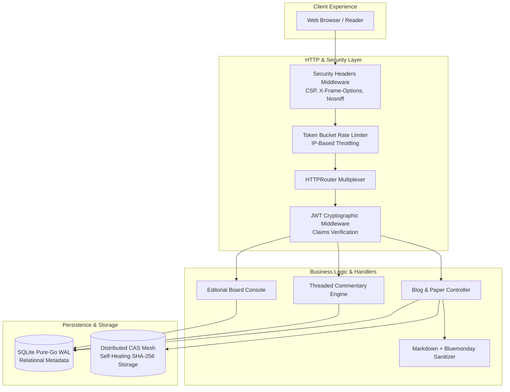

# MintSpace Architecture Documentation

MintSpace is an academic, research-grade publishing engine designed for authors, scientists, and systems engineers who demand typographic clarity, cryptographic integrity, and zero-indirection performance.

---

## 1. Architectural Philosophy

Traditional blogging engines treat articles as mutable database records tied to opaque primary keys. MintSpace treats every manuscript as a **first-class cryptographic artifact**:

1. **Separation of Metadata and Content Payload**:
   * **Metadata Tier (SQLite WAL)**: Handles relational concerns such as authorship, visibility policies (public vs. restricted), endorsement counters, and threaded commentary trees.
   * **Payload Tier (Content-Addressable Storage)**: The canonical Markdown payload is stored separately and addressed strictly by its cryptographic **SHA-256 hash** (`data/blobs/<sha256>.md`).
2. **Reading-Focused Design**:
   * Layout inspired by academic journals, classical game design texts (e.g. *Game Engine Black Book*, *Braid*), and technical monographs.
   * Typographic hierarchy pairing **Constantia** (long-form screen reading serif) with **Consolas** (code listings).
   * Inline LaTeX mathematics powered by KaTeX and interactive vector flowcharts with a full-screen zoom and pan lightbox.

---

## 2. Core Architectural Layers

---

## 3. Data Tier: Embedded SQLite with WAL Mode

MintSpace uses a pure-Go, zero-dependency SQLite driver (`modernc.org/sqlite`). This eliminates CGO dependencies, enabling effortless cross-compilation to Linux, macOS, and Windows.

### Database Connection Configuration
* **Write-Ahead Logging (WAL)**: `_pragma=journal_mode(WAL)` allows concurrent read operations without locking writers.
* **Busy Timeout**: `_pragma=busy_timeout(5000)` ensures transient lock contentions automatically wait up to 5 seconds before failing.
* **Foreign Key Constraints**: `_pragma=foreign_keys(1)` guarantees relational integrity and cascading deletes across users, blogs, comments, and endorsements.

### Relational Schema
* **`users`**: Scholar accounts with bcrypt-hashed passwords and administrative privileges.
* **`blogs`**: Metadata pointers linking author emails, titles, publication dates, and privacy status to a `content_hash`.
* **`comments`**: Recursive tree structure (`parent_id`) allowing arbitrary levels of nested replies.
* **`likes` & `comment_likes`**: Unique endorsements per user preventing duplicate votes.

---

## 4. UI & Rendering Pipeline

1. **LaTeX Mathematics**: KaTeX auto-renders inline formulas (`$...$` and `\(...\)`) and block equations (`$$...$$` and `\[...\]`).
2. **Code Blocks**: Highlight.js formats syntax quietly with an academic header indicating language type (`C++`, `GO`, `BATCH`) and one-click clipboard copying.
3. **Flowcharts & Diagrams (Mermaid.js)**:
   * Diagram code blocks (`flowchart`, `graph`, `sequenceDiagram`) are parsed and rendered via Mermaid into vector SVGs.
   * Rendered diagrams are housed in a dedicated figure container with an integrated **`⤢ Maximize`** button.
   * Clicking the figure launches a full-screen, hardware-accelerated **Lightbox Viewer** supporting mouse wheel zoom (20% to 500%), smooth drag panning, and keyboard shortcuts (<kbd>Esc</kbd>, <kbd>+</kbd>, <kbd>−</kbd>, <kbd>0</kbd>).
