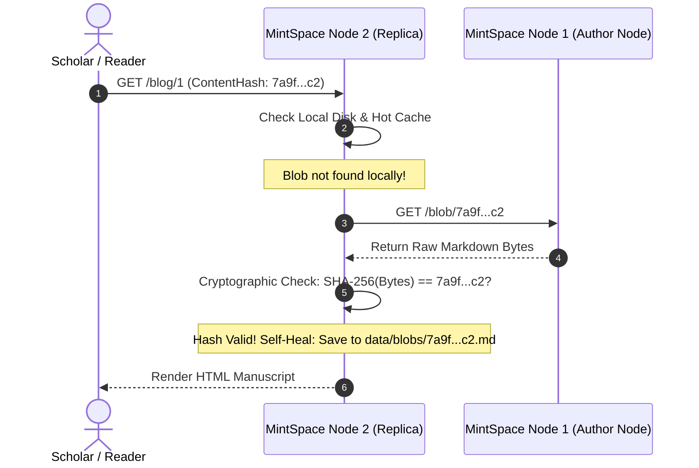

# Distributed Content-Addressable Storage (CAS)

This document outlines the design, protocol, and implementation of MintSpace's **Content-Addressable Storage (CAS)** and its multi-machine distributed mesh.

---

## 1. Why Content-Addressable Storage?

In location-based addressing (URLs, database auto-increment IDs), content is located by *where* it lives. If the server moves, renames, or modifies the file, links break or content is quietly altered.

In Content-Addressable Storage, content is identified by *what* it is:

$$\text{Content ID (CID)} = \text{SHA-256}(\text{Markdown Payload})$$

### Core Advantages:
1. **Tamper Evidence**: Any modification to a manuscript changes its SHA-256 hash immediately. A node cannot secretly alter an article without breaking its canonical reference pointer in the index.
2. **Global Deduplication**: Identical articles submitted multiple times resolve to the exact same file on disk (`data/blobs/<sha256>.md`), saving storage and network bandwidth.
3. **Location Independence**: Because identity is derived from content, the payload can be fetched from the local disk, a peer node in another datacenter, an S3 bucket, or IPFS.

---

## 2. Multi-Machine Distributed Mesh Protocol

MintSpace implements `DistributedCASStorage`, which wraps local storage with an asynchronous replication and self-healing query protocol across a cluster of nodes:



### Self-Healing Resolution Flow
1. **Query Local Primary Store**: Checks the in-memory LRU cache and local filesystem at `data/blobs/<hash>.md`.
2. **Peer Cluster Resolution**: If not found, iterates through configured peers (`PEER_NODES="http://node1:3000,http://node3:3000"`).
3. **Cryptographic Integrity Verification**:
   * The receiving node reads the bytes returned by the peer.
   * It computes `sha256(received_bytes)` and verifies that it **strictly equals** the requested hash.
   * If a malicious or corrupted peer returns mismatched bytes, the node discards the payload with a warning and queries the next peer.
4. **Self-Healing Persistence**: Once verified, the blob is saved directly into the local `data/blobs/<hash>.md` directory and hot cache. Future requests on this node are served locally with zero network hops.

---

## 3. Asynchronous Peer Replication API

When a manuscript is published or updated on Node 1:
1. The author node saves the blob locally.
2. It broadcasts an asynchronous notification in the background to all registered cluster peers:
   ```http
   POST /api/v1/sync/blob HTTP/1.1
   Host: node2:3000
   Content-Type: text/markdown; charset=utf-8
   X-Content-Hash: 7a9f4e...c2

   [Raw Markdown Content]
   ```
3. Node 2 verifies the hash, writes the file to its local CAS disk, and responds with `{"status": "replicated", "hash": "..."}`.

---

## 4. Decentralized Object Adapters (Roadmap)

The `BlobStorage` interface is intentionally minimal to permit drop-in decentralized adapters:

```go
type BlobStorage interface {
    Save(content []byte) (hash string, err error)
    Get(hash string) ([]byte, error)
    Delete(hash string) error
    Exists(hash string) bool
    AddPeer(peerURL string)
    GetPeers() []string
}
```

* **IPFS Adapter**: Automatically pin articles to IPFS nodes or services like Pinata and web3.storage.
* **Arweave Adapter**: Permanent, immutable archiving on the Arweave permaweb.
* **S3 / MinIO Adapter**: High-availability cloud object store backing multi-node clusters.
