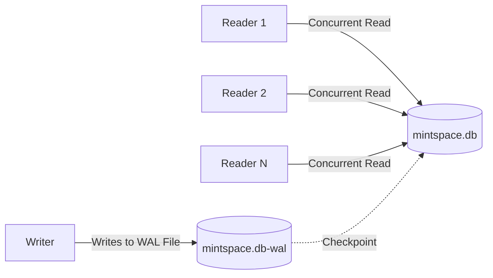

# Security Hardening & Scaling Architecture

This document details the security model, vulnerability defenses, and concurrency scaling strategies implemented in MintSpace.

---

## 1. Security Architecture & Threat Model

### A. Path Traversal & Content Injection Prevention
* **Threat**: Malicious actors supplying manipulated hash strings (e.g., `/blob/../../etc/passwd` or Windows path separators `..\..\Windows\System32`) to read or overwrite arbitrary filesystem locations.
* **Mitigation**: All incoming hash identifiers are validated against strict cryptographic SHA-256 boundaries:
  ```go
  var validHashRegex = regexp.MustCompile(`^[a-fA-F0-9]{64}$`)

  func IsValidHash(hash string) bool {
      return validHashRegex.MatchString(hash)
  }
  ```
  Any request containing characters outside hexadecimal `[0-9a-fA-F]` or whose length is not exactly 64 characters is rejected with `400 Bad Request` before filesystem interaction occurs.

### B. Denial of Service (DoS) & Memory Exhaustion Defenses
1. **Request Body Caps**: Every POST and write endpoint wraps `req.Body` with `http.MaxBytesReader(res, req.Body, 10<<20)` (10MB limit), preventing memory exhaustion from oversized file payloads.
2. **Slowloris & Connection Starvation Timeouts**:
   ```go
   httpServer := http.Server{
       ReadTimeout:  15 * time.Second,
       WriteTimeout: 15 * time.Second,
       IdleTimeout:  60 * time.Second,
   }
   ```
3. **Token Bucket IP Rate Limiting**:
   * Implemented in `rate_limiter.go` without external Redis dependencies.
   * Authentication endpoints (`/login`, `/signup`) are constrained to 2 attempts/sec with a burst of 10.
   * Publishing endpoints (`/write`, `/comment`) are throttled to 3 requests/sec with a burst of 15.
   * Automatically extracts client IPs through `X-Forwarded-For` and `X-Real-IP` when deployed behind load balancers.

### C. Cross-Site Scripting (XSS) Sanitization
* User-submitted Markdown is converted to HTML and passed through **Bluemonday UGC Policy**.
* Allowed tags include academic elements: headings, math wrappers (`<span class="katex">`), formatted code blocks (`<pre><code>`), academic blockquotes, and tables.
* Dangerous tags (`<script>`, `<iframe>`, `onload`, `onerror`) are stripped.

### D. Security Headers Middleware
Every HTTP response automatically includes:
* `X-Content-Type-Options: nosniff`: Prevents MIME-type sniffing.
* `X-Frame-Options: DENY`: Prevents clickjacking within iframes.
* `X-XSS-Protection: 1; mode=block`: Activates browser XSS filters.
* `Referrer-Policy: strict-origin-when-cross-origin`: Restricts referrer data leakage.

---

## 2. Concurrency & Scaling Strategy

### A. SQLite Concurrency (WAL Mode)
SQLite is commonly misunderstood as a single-user database. In **Write-Ahead Logging (WAL)** mode, readers do not block writers, and writers do not block readers.



* **Read Performance**: Pure-Go SQLite in WAL mode can deliver 50,000+ reads/sec with minimal CPU and memory overhead.
* **Busy Timeout**: Configured with `_pragma=busy_timeout(5000)` to automatically queue and serialize concurrent writes during peak spikes without throwing `database locked` errors.

### B. In-Memory Hot Manuscript Cache
* `DistributedCASStorage` contains an internal in-memory cache (`map[string][]byte` guarded by `sync.RWMutex`) storing up to 256 of the most frequently accessed manuscripts.
* Top articles are served directly from RAM without hitting physical disks.

### C. Production Disaster Recovery with Litestream
For multi-node or production failover, **Litestream** can run alongside MintSpace:
* Streams every SQLite WAL frame in real-time to an S3 or Backblaze B2 bucket.
* Delivers continuous replication with sub-second Recovery Point Objective (RPO) and instant point-in-time recovery without complex cluster orchestration.
